# SRM SPIRITUAL COMMUNITY MOBILE APPLICATION

_A unified digital platform for SwaRaj Kriya practice, spiritual content and community | SRM Community_

## Functional Specification Document

Version 1.0 • September 2026

Prepared by Indus Net Technologies Limited (INT.)

# Document Release History

| **Sl No** | **Version No.** | **Release Date** | **Prepared by** | **Reasons for Change** |
|---|---|---|---|---|
| 1 | 1.0 | Sep 2026 | INT | Initial Version |

# Circulation Details

A soft copy of this draft is intended for SRM Community project stakeholders and the INT delivery team on the agreed project repository, with appropriate access control.

No controlled hard copy of this document shall exist unless specifically required and approved by the Project Manager. If a controlled hard copy is issued, record the details below.

| **Copy No.** | **Designation of Copy Holder** | **Location of the Copy** |
|---|---|---|
| 1 |  |  |

# Table of Content

## Contents

- **1 Introduction** — **9**
  - 1.1 Purpose of the Document — 9
  - 1.2 Scope — 9
  - 1.3 User Types — 9
  - 1.4 User Definition — 10
  - 1.5 Out of Scope — 10
- **2 Detailed Functional Specifications** — **11**
  - 2.1 Registration, Authentication & Session Management — 11
    - 2.1.1 Module Overview — 11
    - 2.1.2 Key Characteristics — 11
    - 2.1.3 Flow Diagrams — 12
    - 2.1.5 Functional Flow — 12
    - 2.1.8 User Permissions — 13
    - 2.1.10 User Stories — 13
    - 2.1.12 Validation Rules — 14
    - 2.1.13 Dependencies — 14
    - 2.1.14 Acceptance Testing Scenarios — 14
    - 2.1.15 Assumptions — 15
    - 2.1.16 Constraints — 15
  - 2.2 User Access, Profile & Account Management — 16
    - 2.2.1 Module Overview — 16
    - 2.2.2 Key Characteristics — 16
    - 2.2.3 Flow Diagrams — 17
    - 2.2.5 Functional Flow — 17
    - 2.2.8 User Permissions — 17
    - 2.2.10 User Stories — 18
    - 2.2.12 Validation Rules — 18
    - 2.2.13 Dependencies — 18
    - 2.2.14 Acceptance Testing Scenarios — 19
    - 2.2.15 Assumptions — 19
    - 2.2.16 Constraints — 19
  - 2.3 SwaRaj Kriya Application, Approval & Eligibility — 20
    - 2.3.1 Module Overview — 20
    - 2.3.2 Key Characteristics — 20
    - 2.3.3 Flow Diagrams — 21
    - 2.3.5 Functional Flow — 21
    - 2.3.8 User Permissions — 21
    - 2.3.10 User Stories — 22
    - 2.3.12 Validation Rules — 22
    - 2.3.13 Dependencies — 22
    - 2.3.14 Acceptance Testing Scenarios — 23
    - 2.3.15 Assumptions — 23
    - 2.3.16 Constraints — 23
  - 2.4 Home & Access-Based Experience — 24
    - 2.4.1 Module Overview — 24
    - 2.4.2 Key Characteristics — 24
    - 2.4.3 Flow Diagrams — 25
    - 2.4.5 Functional Flow — 25
    - 2.4.8 User Permissions — 25
    - 2.4.10 User Stories — 26
    - 2.4.12 Validation Rules — 26
    - 2.4.13 Dependencies — 26
    - 2.4.14 Acceptance Testing Scenarios — 27
    - 2.4.15 Assumptions — 27
    - 2.4.16 Constraints — 27
  - 2.5 SwaRaj Kriya Content & Offline Media — 28
    - 2.5.1 Module Overview — 28
    - 2.5.2 Key Characteristics — 28
    - 2.5.3 Flow Diagrams — 29
    - 2.5.5 Functional Flow — 29
    - 2.5.8 User Permissions — 29
    - 2.5.10 User Stories — 30
    - 2.5.12 Validation Rules — 30
    - 2.5.13 Dependencies — 31
    - 2.5.14 Acceptance Testing Scenarios — 31
    - 2.5.15 Assumptions — 31
    - 2.5.16 Constraints — 31
  - 2.6 SwaRaj Kriya Session Execution & Playback — 32
    - 2.6.1 Module Overview — 32
    - 2.6.2 Key Characteristics — 32
    - 2.6.3 Flow Diagrams — 33
    - 2.6.5 Functional Flow — 33
    - 2.6.8 User Permissions — 33
    - 2.6.10 User Stories — 34
    - 2.6.12 Validation Rules — 34
    - 2.6.13 Dependencies — 34
    - 2.6.14 Acceptance Testing Scenarios — 35
    - 2.6.15 Assumptions — 35
    - 2.6.16 Constraints — 35
  - 2.7 Offline Count Tracking & Two-Way Synchronization — 36
    - 2.7.1 Module Overview — 36
    - 2.7.2 Key Characteristics — 36
    - 2.7.3 Flow Diagrams — 37
    - 2.7.5 Functional Flow — 37
    - 2.7.8 User Permissions — 37
    - 2.7.10 User Stories — 38
    - 2.7.12 Validation Rules — 38
    - 2.7.13 Dependencies — 38
    - 2.7.14 Acceptance Testing Scenarios — 39
    - 2.7.15 Assumptions — 39
    - 2.7.16 Constraints — 39
  - 2.8 Distraction & Interruption Tracking — 40
    - 2.8.1 Module Overview — 40
    - 2.8.2 Key Characteristics — 40
    - 2.8.3 Flow Diagrams — 41
    - 2.8.5 Functional Flow — 41
    - 2.8.8 User Permissions — 41
    - 2.8.10 User Stories — 42
    - 2.8.12 Validation Rules — 42
    - 2.8.13 Dependencies — 42
    - 2.8.14 Acceptance Testing Scenarios — 43
    - 2.8.15 Assumptions — 43
    - 2.8.16 Constraints — 43
  - 2.9 Post-Kriya Feedback & Emotional State — 44
    - 2.9.1 Module Overview — 44
    - 2.9.2 Key Characteristics — 44
    - 2.9.3 Flow Diagrams — 45
    - 2.9.5 Functional Flow — 45
    - 2.9.8 User Permissions — 45
    - 2.9.10 User Stories — 45
    - 2.9.12 Validation Rules — 46
    - 2.9.13 Dependencies — 46
    - 2.9.14 Acceptance Testing Scenarios — 46
    - 2.9.15 Assumptions — 47
    - 2.9.16 Constraints — 47
  - 2.10 My Kriya, History & Reports — 48
    - 2.10.1 Module Overview — 48
    - 2.10.2 Key Characteristics — 48
    - 2.10.3 Flow Diagrams — 49
    - 2.10.5 Functional Flow — 49
    - 2.10.8 User Permissions — 49
    - 2.10.10 User Stories — 50
    - 2.10.12 Validation Rules — 50
    - 2.10.13 Dependencies — 50
    - 2.10.14 Acceptance Testing Scenarios — 51
    - 2.10.15 Assumptions — 51
    - 2.10.16 Constraints — 51
  - 2.11 Practice, Audio & Bookmarks — 52
    - 2.11.1 Module Overview — 52
    - 2.11.2 Key Characteristics — 52
    - 2.11.3 Flow Diagrams — 53
    - 2.11.5 Functional Flow — 53
    - 2.11.8 User Permissions — 53
    - 2.11.10 User Stories — 54
    - 2.11.12 Validation Rules — 54
    - 2.11.13 Dependencies — 55
    - 2.11.14 Acceptance Testing Scenarios — 55
    - 2.11.15 Assumptions — 55
    - 2.11.16 Constraints — 55
  - 2.12 Explore SRM & Public/Premium Content — 56
    - 2.12.1 Module Overview — 56
    - 2.12.2 Key Characteristics — 56
    - 2.12.3 Flow Diagrams — 57
    - 2.12.5 Functional Flow — 57
    - 2.12.8 User Permissions — 57
    - 2.12.10 User Stories — 58
    - 2.12.12 Validation Rules — 58
    - 2.12.13 Dependencies — 58
    - 2.12.14 Acceptance Testing Scenarios — 59
    - 2.12.15 Assumptions — 59
    - 2.12.16 Constraints — 59
  - 2.13 Payments, Subscription & Renewal — 60
    - 2.13.1 Module Overview — 60
    - 2.13.2 Key Characteristics — 60
    - 2.13.3 Flow Diagrams — 61
    - 2.13.5 Functional Flow — 61
    - 2.13.8 User Permissions — 61
    - 2.13.10 User Stories — 62
    - 2.13.12 Validation Rules — 62
    - 2.13.13 Dependencies — 62
    - 2.13.14 Acceptance Testing Scenarios — 63
    - 2.13.15 Assumptions — 63
    - 2.13.16 Constraints — 63
  - 2.14 Notifications — 64
    - 2.14.1 Module Overview — 64
    - 2.14.2 Key Characteristics — 64
    - 2.14.3 Flow Diagrams — 64
    - 2.14.5 Functional Flow — 65
    - 2.14.8 User Permissions — 65
    - 2.14.10 User Stories — 65
    - 2.14.12 Validation Rules — 66
    - 2.14.13 Dependencies — 66
    - 2.14.14 Acceptance Testing Scenarios — 66
    - 2.14.15 Assumptions — 66
    - 2.14.16 Constraints — 67
  - 2.15 Language & Localization — 68
    - 2.15.1 Module Overview — 68
    - 2.15.2 Key Characteristics — 68
    - 2.15.3 Flow Diagrams — 69
    - 2.15.5 Functional Flow — 69
    - 2.15.8 User Permissions — 69
    - 2.15.10 User Stories — 69
    - 2.15.12 Validation Rules — 70
    - 2.15.13 Dependencies — 70
    - 2.15.14 Acceptance Testing Scenarios — 70
    - 2.15.15 Assumptions — 70
    - 2.15.16 Constraints — 70
  - 2.16 Kriya Leader, Group & WhatsApp Communication — 71
    - 2.16.1 Module Overview — 71
    - 2.16.2 Key Characteristics — 71
    - 2.16.3 Flow Diagrams — 72
    - 2.16.5 Functional Flow — 72
    - 2.16.8 User Permissions — 72
    - 2.16.10 User Stories — 73
    - 2.16.12 Validation Rules — 73
    - 2.16.13 Dependencies — 73
    - 2.16.14 Acceptance Testing Scenarios — 74
    - 2.16.15 Assumptions — 74
    - 2.16.16 Constraints — 74
  - 2.17 Help, Quarterly Feedback, Policies & Consent — 75
    - 2.17.1 Module Overview — 75
    - 2.17.2 Key Characteristics — 75
    - 2.17.3 Flow Diagrams — 76
    - 2.17.5 Functional Flow — 76
    - 2.17.8 User Permissions — 76
    - 2.17.10 User Stories — 77
    - 2.17.12 Validation Rules — 77
    - 2.17.13 Dependencies — 77
    - 2.17.14 Acceptance Testing Scenarios — 78
    - 2.17.15 Assumptions — 78
    - 2.17.16 Constraints — 78
  - 2.18 Admin Portal — 79
    - 2.18.1 Module Overview — 79
    - 2.18.2 Key Characteristics — 79
    - 2.18.3 Flow Diagrams — 80
    - 2.18.5 Functional Flow — 80
    - 2.18.8 User Permissions — 81
    - 2.18.10 User Stories — 81
    - 2.18.12 Validation Rules — 82
    - 2.18.13 Dependencies — 82
    - 2.18.14 Acceptance Testing Scenarios — 83
    - 2.18.15 Assumptions — 83
    - 2.18.16 Constraints — 83
  - 2.19 Role Comparison: Guest vs Registered/Premium vs SwaRaj Kriya User — 84
  - 2.20 Role Comparison: Kriya Leader vs Admin — 84
- **3 Non-Functional Requirements (NFR)** — **85**
  - 3.1 Performance — 85
  - 3.2 Availability & Offline Resilience — 85
  - 3.3 Security & API Protection — 85
  - 3.4 Privacy & Compliance — 86
  - 3.5 Compatibility & Device Support — 86
  - 3.6 Logging, Monitoring & Supportability — 86
  - 3.7 Usability & Accessibility — 86
  - 3.8 Hosting, Architecture & Technology Decisions — 86
- **Appendix A: SLA Alignment** — **88**
- **Appendix B: Role Capability Summary** — **89**
- **Appendix C: Glossary** — **90**
- **Document Sign-Off** — **91**

# 1 Introduction

## 1.1 Purpose of the Document

This Functional Specification Document (FSD) defines the current functional behaviour of the SRM Spiritual Community Mobile Application and supporting Web Admin Portal for design, development, quality assurance, client validation and User Acceptance Testing.

_Document status: Draft for Client Validation. It becomes a build baseline only after the open items identified within the relevant modules are confirmed and the sign-off section is completed._

## 1.2 Scope

This FSD covers the current <mark>Phase 1</mark> mobile experience and the supporting Web Admin Portal. The solution focuses on simple access to spiritual content, SwaRaj Kriya practice, offline-capable audio/practice, accurate activity/count synchronization, subscriptions, Kriya Leader/group operations, administrative management and involved other roles.

- Mobile experiences for pre-login/guest users, registered users, premium subscribers, SwaRaj Kriya users and Kriya Leaders where applicable.

- Web Admin Portal for administrator users only. Admin users managing ~~user, SK, Leader/group~~, content, payment, count, reporting, configuration and operational management.

- Online, Offline, Airplane Mode and multi-device synchronization handling for agreed practice/count scenarios. On a shared device, if a user logs out with unsynced sessions, an alert is shown and those sessions are deleted on confirmation without being synchronized. Where the same user is logged in on multiple devices, the server combines and de-duplicates sessions from all devices and returns the updated history and counts to each device at its next sync.

- Razorpay-based online payments plus Admin-recorded offline payments.

- English and Hindi localization of the application interface: menus, screen headings, labels, buttons, system messages and any other static text that is not part of content. Content itself is not translated.  The menu items and headings can be managed and updated in both languages through the Admin Portal using the multilingual options.

- Current Phase 1 excludes Events and course functionality; broader website-app synchronization and SSO are deferred.

- Multi currency payments via razorpay (USD and INR) is considered.

## 1.3 User Types

- Guest / Pre-login User

- Registered User

- Premium Subscriber

- SwaRaj Kriya User (Practitioner)

- Kriya Leader

- Admin

## 1.4 User Definition

| **Role** | **Definition** |
|---|---|
| Guest / Pre-login User | A person using the application without authentication. May view the welcome content and browse free conten.  The user shall also have the option to register as a user from the same interface and subsequently log in using the log-in option. |
| Registered User | An authenticated mobile-app user. May access free content  and features according to Admin configuration. May purchase premium access and may apply for SwaRaj Kriya. |
| Premium Subscriber | A registered user holding an active paid content subscription. On the basis of the subscription subscriber will receive premium content |
| SwaRaj Kriya User | A user approved by Admin for SwaRaj Kriya after completing the offline process, the SwaRaj Kriya course, and online payment (or renewal) of the subscription. The user receives the SwaRaj Kriya practice experience and alerts for online payment renewal, is mapped to a Kriya Leader/group, and also receives applicable Premium content. |
| Kriya Leader | A user designated by Admin to guide/manage assigned participant groups operationally. Communication with participants is expected through WhatsApp outside the application. |
| Admin | An authorized web-portal user, assigned one of the following RBAC roles, responsible for operational governance within that role's access: ● **Super Admin:** full access to all modules and features. ● **Content Admin:** Bhakti, Practice, and Videos & Talks content. ● **Blog Admin:** blog management. ● **Event Admin:** event management. ● **Swaraj Kriya Admin:** SwaRaj Kriya-related features. ● **Finance Admin:** payment and finance-related features. Sub-admins send a request to the Admin user (excluding Sri Guru's email ID) to publish content, and are notified when it is published. Both notifications are sent by email. |

## 1.5 Out of Scope

- Course management, course enrollment/progress/certification and course-authoring functionality.

- Events module for the current Phase 1, including event discovery/registration/payment. Event integration with the existing website is deferred.

- ~~Initial-Phase 1 SSO with the existing SRM website; SSO may be evaluated in a future phase. Professional Wording~~

- In Phase 1, the user’s profile type shall be validated during login to determine the applicable access and permissions. SSO-based authentication is out of scope for Phase 1.

- ~~Automated two-way website-app synchronization for users/content/events in the initial release; broader synchronization is a later-phase item.~~

- In-app peer-to-peer chat/social-network features. Kriya Leader communication is expected through WhatsApp outside the SRM app.

- ~~Leader/Guru course/content/event authoring capabilities from older proposal language, unless separately reconfirmed.~~

- AI/ML recommendation, wearables integration, gamification and other earlier proposal exclusions not reconfirmed for this Phase 1.

# 2 Detailed Functional Specifications

The structure below follows the approved FSD template. Each module states confirmed functionality and explicitly carries unresolved decisions in Assumptions/Constraints rather than inventing missing rules.

## 2.1 Registration, Authentication & Session Management

### 2.1.1 Module Overview

#### 2.1.1.1 Purpose

To provide secure registration and login for mobile users while supporting migration of the existing SRM user base and a session experience suitable for older users.

#### 2.1.1.2 Scope

~~In scope: mobile registration for new users, OTP-based login, one-time migration of existing users from the current SRM database so that they can log in to the new application, persistent sessions, logout, account-session invalidation, already selected mandatory Terms & Conditions acceptance during registration, and Admin Portal authentication. Only the migration of existing data is done for now. There is no sign-in link or ongoing data synchronization with the existing website, and SSO with it is not part of the initial Phase 1.~~

In scope: mobile registration for new users, OTP-based login, Google and Apple sign-in, one-time migration of existing users from the current SRM database so that they can log in to the new application, persistent sessions, login on multiple devices, logout, account-session invalidation, mandatory acceptance of the Terms & Conditions and Privacy Policy by the user during registration (not selected by default), and Admin Portal authentication. Only the migration of existing data is done for now. There is no ongoing data synchronization or shared login with the existing website.

#### 2.1.1.3 Target Users

Guest, Registered User, Premium Subscriber, SwaRaj Kriya User, Kriya Leader; Admin for the Web Admin Portal.

#### 2.1.1.4 High-Level Functionality

The current release will support an application identity that can recognize migrated existing SRM users and new mobile registrations. OTP is the primary login method. The preferred session behaviour is to keep users signed in until they explicitly log out or the session is invalidated. Automated website-app synchronization and ~~SSO remain future considerations.~~

#### 2.1.1.5 Application Channel

| **Channel** | **Applicable?** | **Notes** |
|---|---|---|
| Web | Yes | Admin Portal authentication; existing website/database is a source for migration and identity assessment. |
| Mobile (iOS/Android) | Yes | Registration, OTP login, Google and Apple sign-in, session persistence and logout. |

### 2.1.2 Key Characteristics

#### 2.1.2.1 Functional Capabilities

- Mobile registration for new users, subject to final alignment with the existing SRM identity architecture.

- <mark>OTP-based login. The OTP is sent through SMS, WhatsApp and email.</mark>

- OTP auto-fill where supported by the device/platform.

- ~~Existing SRM users to be migrated for the current release based on data and authentication details supplied by SRM.~~

- Existing SRM users are migrated once from the current SRM database for the current release, using the look-up table data supplied by SRM (web.seva team). The migration covers the users’ information, user role, programme type (P1/P2) and assigned Kriya Leader. Past records of the existing users are not migrated. After migration, users log in to the new application with OTP or, if social sign-in is offered, with social sign-in. If a mobile number is not linked with the social credential, the user is asked to enter and verify a mobile number by OTP after signing in. If the number matches an existing or migrated user, the social sign-in is linked to that account. If not, the user completes registration and a new account is created. An account is never created without a verified mobile number.

- Persistent login so users remain signed in until explicit logout or server-side/session invalidation.

- Google Login feasibility to be assessed; Sign in with Apple requirement to be assessed if Google/social login is offered on iOS.

- Google sign-in and, on iOS, Sign in with Apple, in addition to OTP login.

- Capture mandatory T&C acceptance” becomes: the consent checkbox is not selected by default. The user must select it to register. Add persistent sessions and multi-device login.

- Admin Portal login protected by authentication and role-based authorization.

#### 2.1.2.3 Operational Rules

- ~~The exact relationship between mobile registration and the existing website identity store is Pending SRM/technical confirmation.~~

- Mobile registration and the existing website identity are linked only through a one-time migration of the basic information of existing users, along with their user role, programme type (P1/P2) and assigned Kriya Leader. Past records of the existing users are not migrated. At login, the user is matched to the migrated information.

- Existing users are migrated once, and the migrated data is used as a lookup at login. There is no shared login with the existing SRM website. Google and Apple sign-in are covered in 2.1.2.1.

- For the November release, existing user data migration is required; broader automated two-way website-app synchronization is planned for a later phase.

- International OTP delivery must be considered for users in locations such as Singapore, Dubai, US, Canada and other countries.

- Users remain signed in until logout or invalidation.

- Concurrent-device/session policy must be finalized before build completion.

### 2.1.3 Flow Diagrams

#### 2.1.3.1 Registration, Authentication & Session Management Flow

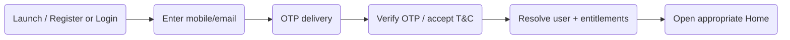

_Figure 2.1.3.1 – Registration, Authentication & Session Management high-level flow_

### 2.1.5 Functional Flow

#### 2.1.5.1 Registration / first access

1. User opens the app, at first a splash screen will be shown <mark>then the  user shall be presented with the login screen, providing options to log in using their mobile number</mark>

2. For a new user, the app captures the agreed registration fields and mandatory consent.

3. For an existing migrated user, the app identifies the user from the migrated record.

4. OTP is sent through the configured channel and verified.

5. The system establishes the session and loads the applicable access state and opens the landing page .

#### 2.1.5.2 Return to app

1. User reopens the app.

2. If the session is still valid, the app restores the signed-in state without a new OTP.

3. If the session has been invalidated, the app returns to OTP login.

4. opens the landing page (see 2.4.5.1)

#### 2.1.5.3 Fetching SwaRaj Kriya status, programme and Kriya Leader at login

1. The user logs in with OTP, or with Google or Apple sign-in. If no mobile number is linked with the social credential, the user enters and verifies a mobile number by OTP.

2. The system looks up the verified mobile number in the migrated look-up data.

3. If a record is found, the system checks whether the user is a SwaRaj Kriya holder.

4. If the user is a SwaRaj Kriya holder, the system also fetches the user’s programme (P1/P2) and assigned Kriya Leader.

5. Opens the landing page (see 2.4.5.1)

6. If no record is found, the user is registered as a new user.

### 2.1.8 User Permissions

#### 2.1.8.1 Role Definitions

Guest, Registered User, Premium Subscriber, SwaRaj Kriya User, Kriya Leader; Admin for the Web Admin Portal.

#### 2.1.8.2 Allowed Operations

- Register/login through supported flows.

- Remain signed in while the session is valid.

- Log out explicitly.

- Admin may authenticate to the Web Admin Portal using authorized credentials.

#### 2.1.8.3 Restricted Operations

- Guest cannot access protected user data.

- No user may bypass OTP or authorization checks.

### 2.1.10 User Stories

#### 2.1.10.1 Register and sign in with OTP

| **Story ID** | US-AUTH-01 |
|---|---|
| **Primary Actor(s)** | New / Existing User |
| **User Story** | As a user, I want to register or sign in using a simple OTP flow so that I can access the application without managing a complex password. |
| **Acceptance Criteria** | • OTP is sent through the configured channel. • Valid OTP establishes a session. • Terms & Conditions acceptance is captured during registration. • Migrated existing users can be recognized after data migration. |
| **Exception Scenarios** | •The system will trigger OTP upto 3 times.  If OTP delivery fails -> a plain-language retry message is shown. • Identity record cannot be resolved -> access is not granted and the issue is logged. |
| **Dependencies** | • SRM authentication/database details. • OTP provider and channel decision. |

#### 2.1.10.2 Stay signed in

| **Story ID** | US-AUTH-02 |
|---|---|
| **Primary Actor(s)** | Registered User |
| **User Story** | As a user, I want the app to keep me signed in so that repeated OTP entry does not create friction. |
| **Acceptance Criteria** | • A valid session is restored on app relaunch. • User remains signed in until logout or invalidation without any impact on his user type. |
| **Exception Scenarios** | • Session invalidated -> user is returned to login. |
| **Dependencies** | • Final session/token design. |

#### 2.1.10.3 Consent (not selected by default)

| **Story ID** | US-AUTH-03 |
|---|---|
| **Primary Actor(s)** | New / Existing User |
| **User Story** | As a new user, I want to read and actively accept the Terms & Conditions and Privacy Policy before registering, so that my consent is given by my own choice and recorded. |
| **Acceptance Criteria** | • The consent checkbox is not selected when the registration form opens, including when the form is reopened. • Links to the Terms & Conditions and Privacy Policy are shown beside it. • The Register action is available only when the checkbox is selected. • On registration, the consent is recorded with the user ID, the policy versions and a timestamp. |
| **Exception Scenarios** | • Checkbox not selected -> Register is disabled. If the user tries to continue, the message “Please accept the Terms & Conditions and Privacy Policy to register.” is shown, and no account is created. • User selects the checkbox, then unselects it -> Register is disabled again. • Policy content cannot be loaded -> registration cannot be completed, and the user sees “Unable to load the Terms & Conditions. Please try again.” • User leaves the form and returns -> the checkbox is not selected. |
| **Dependencies** |  |

#### 2.1.10.4 Multi-device

| **Story ID** | US-AUTH-04 |
|---|---|
| **Primary Actor(s)** | New / Existing User |
| **User Story** | As a user, I want to log in on more than one device so that I can use the app on each of them. |
| **Acceptance Criteria** | ● The same user can be logged in on several devices at the same time. Logging in on a new device does not log out the others. ● Logging out on one device does not log out the other devices. ● If Admin ends the account, all of the user’s sessions end. ● Practice data from all devices is combined on the server, and each device receives the combined history at its next sync (the multi-device decision, option 2B). |
| **Exception Scenarios** | ● User logs out on one device with unsynced sessions -> the alert from the logout decision is shown for that device only. |
| **Dependencies** |  |

#### 2.1.10.5 Persistent session

| **Story ID** | US-AUTH-04 |
|---|---|
| **Primary Actor(s)** | New / Existing User |
| **User Story** | As a registered user, I want to stay signed in on my device so that I don’t need an OTP every time I open the app. |
| **Acceptance Criteria** | ● A valid session is restored when the app is reopened, without a new OTP. ● The session ends only when the user logs out or the server ends it. ● An app update keeps the session. |
| **Exception Scenarios** | ● Account blocked, deactivated, merged or deleted by Admin -> the session is ended, the user is returned to the login screen, and sees “Your account is not active. Please contact the SRM Technical Helpline.” ● App reopened offline with a valid session -> the user is let in, using the last confirmed access state. ● App uninstalled and reinstalled -> the user must log in again. ● Session cannot be verified (server error) -> access is not widened beyond the last confirmed state, and the error is logged. |
| **Dependencies** |  |

#### <u>2.1.10.6 Multiple User (Single Device)</u>

| **Story ID** | US-AUTH-05 |
|---|---|
| **Primary Actor(s)** | SwaRaj Kriya User; any registered user sharing a device |
| **User Story** | As a user who shares a device with another user, I want my offline practice data kept separate and handled clearly when I log out, so that my data is not mixed with or seen by the other user. |
| **Acceptance Criteria** | • Kriya done offline is stored on the device against the logged-in user and synchronized when connectivity is available. • Each user’s offline activity data is kept separate on the device. • If a user logs out with unsynchronized sessions, an alert is shown: “You have X sessions not yet synced. If you log out now, they will be lost.” • If the user confirms, the unsynchronized sessions are deleted from the device and are never synchronized or stored centrally. • If the user cancels, they stay logged in. • A user who logs in next on the same device cannot see the previous user’s offline activity data. |
| **Exception Scenarios** | • No unsynchronized sessions -> the user is logged out without an alert. • The deleted sessions do not return if the same user logs in again on that device. |
| **Dependencies** |  |

### 2.1.12 Validation Rules

#### 2.1.12.2 Business Rules

- Registration fields and mandatory consent must be completed before account creation.

- OTP must be valid and within the configured validity period.

- Only authorized Admin credentials and SK Leaders may access the Admin Portal or Leader’s Dashboard.

### 2.1.13 Dependencies

- SRM existing database and authentication architecture details.

- OTP provider and international delivery coverage.

- Privacy Policy and Terms & Conditions content for registration acceptance.

### 2.1.14 Acceptance Testing Scenarios

#### 2.1.14.1 Core Functionality Testing

| **Test ID** | **Scenario** | **Expected Result** |
|---|---|---|
| TC-AUTH-001 | Register a new mobile-app user with valid data and OTP | Account/session created and user enters the application. |
| TC-AUTH-002 | Existing migrated SRM user logs in with valid OTP | User is recognized and correct access state is loaded. |
| TC-AUTH-003 | Relaunch app with a valid session | User remains signed in without a new OTP. |
| TC-AUTH-004 | Explicitly log out | Session is ended and login is shown. |
| TC-AUTH-005 | Attempt Admin Portal access without valid authorization | Access is denied. |

#### 2.1.14.4 Edge Cases

| **Test ID** | **Scenario** | **Expected Result** |
|---|---|---|
| TC-AUTH-006 | OTP provider is temporarily unavailable | User receives a non-technical retry message; no partial session is created. |
| TC-AUTH-007 | Migrated identity exists with incomplete application profile | User is handled according to migration mapping rules; missing data is flagged rather than invented. |

### 2.1.15 Assumptions

- Existing SRM user data can be exported/mapped for the current release.

- OTP-based authentication remains the primary login mechanism.

### 2.1.16 Constraints

- Exact registration ownership between website and app requires final architecture alignment.

- OTP fallback channels, social login and concurrent-device policy remain Pending SRM/technical confirmation.

## 2.2 User Access, Profile & Account Management

### 2.2.1 Module Overview

#### 2.2.1.1 Purpose

To control access to public, logged-in, premium and SwaRaj Kriya content and to provide users with profile and account-management capabilities.

#### 2.2.1.2 Scope

In scope: profile viewing and editing, entitlement display, account deletion, logout, assigned Leader visibility for SwaRaj Kriya users, subscription status display, and access enforcement. The profile captures the following fields: name, phone number, email, gender, date of birth, country and city. Only country and city are editable.

#### 2.2.1.3 Target Users

Registered User, Premium Subscriber, SwaRaj Kriya User, Kriya Leader; Admin manages records in the Admin Portal.

#### 2.2.1.4 High-Level Functionality

Access is determined using login state, premium entitlement and SwaRaj Kriya-holder status. Pre-login users can view the welcome content and browse free content. Logged-in users receive additional access, while SK holders receive the SwaRaj Kriya experience and also receive applicable premium content.

#### 2.2.1.5 Application Channel

| **Channel** | **Applicable?** | **Notes** |
|---|---|---|
| Web | Yes | Admin manages user records and access through the Admin Portal. |
| Mobile (iOS/Android) | Yes | Users view account/profile, subscription/entitlement status and account actions. |

### 2.2.2 Key Characteristics

#### 2.2.2.1 Functional Capabilities

- Display user profile and account status.

- Display premium/subscription and SwaRaj Kriya entitlement in plain language with message to educate and get users to sign up for premium subscription and swaraj kriya  along with link to contact SRM Helpline over email or whatsApp.

- Display assigned Kriya Leader and SK program for SK participants where applicable.

- Allow permitted profile-field edits; exact editable field (Name, Phone Number, Email Address, Gender, Date of Birth, City & Country).

- Provide account deletion because the mobile application supports registration.

- Enforce free and premium access rules on protected content. .

- ~~Allow Admin to configure which content is available to free/public users.~~

- Allow Admin to configure content as free or paid (premium) dynamically through the Admin Portal. Free content can be browsed by guest users.

#### 2.2.2.3 Operational Rules

- ~~The exact entitlement matrix is still being finalized.~~

- SK holders, as paid users, should have access to applicable premium content; this supersedes the earlier assumption that SK and premium access were fully independent, subject to final client sign-off.

- Account deletion scope must align with the final shared-identity model; whether deletion also affects the existing website account requires confirmation.

- User-specific practice/count data must never be exposed across different profiles on the same device.

### 2.2.3 Flow Diagrams

#### 2.2.3.1 User Access, Profile & Account Management Flow

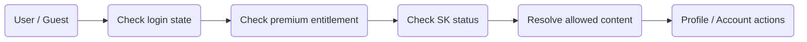

_Figure 2.2.3.1 – User Access, Profile & Account Management high-level flow_

### 2.2.5 Functional Flow

#### 2.2.5.1 Access evaluation

1. System identifies whether the person is pre-login or authenticated.

2. For authenticated users, premium entitlement and SK-holder status are evaluated.

3. The app exposes only the content and functions allowed for the resolved state.

#### 2.2.5.2 Delete account

1. User opens account settings and selects Delete Account.

2. The app presents confirmation and any required re-authentication.

3. On confirmation, the application initiates account deletion according to the final identity/data-retention rules.

### 2.2.8 User Permissions

#### 2.2.8.1 Role Definitions

Registered User, Premium Subscriber, SwaRaj Kriya User, Kriya Leader; Admin manages records in the Admin Portal.

#### 2.2.8.2 Allowed Operations

- View own profile and entitlement status.

- Edit permitted profile fields.

- Delete own mobile-app account through the approved flow.

- View assigned Leader where applicable.

#### 2.2.8.3 Restricted Operations

- User cannot alter own subscription/SK entitlement directly.

- User cannot view another user profile or practice data.

- User cannot change Admin-assigned Leader/group mapping.

### 2.2.10 User Stories

#### 2.2.10.1 Understand my access

| **Story ID** | US-USER-01 |
|---|---|
| **Primary Actor(s)** | Premium / SK User |
| **User Story** | As a user, I want to understand what content and practice access I currently have so that locked content is not confusing. |
| **Acceptance Criteria** | • Profile clearly states applicable access. • Protected content checks the same entitlement before opening. • SK holders receive applicable SK and premium access. • SK Holder and Premium Holder will have the same plan only basis the eligibility (SK access ) |
| **Exception Scenarios** | • Entitlement cannot be resolved -> protected access fails closed and the issue is logged. |
| **Dependencies** | • Final entitlement matrix. |

#### 2.2.10.2 Delete my account

| **Story ID** | US-USER-02 |
|---|---|
| **Primary Actor(s)** | Registered User |
| **User Story** | As a registered user, I want a clear account deletion option so that I can remove my mobile-app account when required. |
| **Acceptance Criteria** | • Delete Account is available in account settings. • The user must confirm before deletion starts. • Local user data is cleared as part of completed deletion/logout cleanup as applicable. |
| **Exception Scenarios** | • Shared website identity impact is unresolved -> deletion follows the approved final mapping only. |
| **Dependencies** | • Final identity and retention rules. |

### 2.2.12 Validation Rules

#### 2.2.12.2 Business Rules

- Only the authenticated user may update their own editable profile fields.

- Entitlement-changing fields are read-only to end users.

- Delete Account requires explicit confirmation and follows approved retention/compliance rules.

### 2.2.13 Dependencies

- Final content-access matrix.

- Identity/deletion relationship with existing SRM website.

- Subscription module.

- Leader/group mapping.

### 2.2.14 Acceptance Testing Scenarios

#### 2.2.14.1 Core Functionality Testing

| **Test ID** | **Scenario** | **Expected Result** |
|---|---|---|
| TC-USER-001 | Guest opens public content | Only configured public content is available. |
| TC-USER-002 | Logged-in free user opens premium content | Access is denied or purchase route is shown. |
| TC-USER-003 | SK holder opens SK and applicable premium content | Access is granted |
| TC-USER-004 | User edits an allowed profile field | Change is saved and reflected on reload. |
| TC-USER-005 | User completes account deletion flow | Deletion is processed according to approved identity/retention rules. |

#### 2.2.14.4 Edge Cases

| **Test ID** | **Scenario** | **Expected Result** |
|---|---|---|
| TC-USER-006 | Entitlement service unavailable | Protected access is not granted until entitlement can be resolved. |
| TC-USER-007 | Different user logs in on same device | Previous user-specific profile/count data is not exposed to the new user. |

### 2.2.15 Assumptions

- Free content is configured by Admin.

- The application may be accessed by multiple users on the same device. When a user performs Kriya in offline mode, the session is stored on the device and synchronized to the central database when connectivity is available. If the user logs out before this happens, the application shows an alert: “You have X sessions not yet synced. If you log out now, they will be lost.” If the user confirms, the unsynchronized sessions are deleted from the device and are never synchronized or stored centrally. If the user cancels, they stay logged in. If another user subsequently logs in on the same device, they will not have access to the previous user’s data. The application keeps each user’s data isolated, so no user’s offline activity data can be accessed by another user.

### 2.2.16 Constraints

- ~~Final user-category entitlement and deletion propagation rules remain Pending SRM Confirmation.~~

## 2.3 SwaRaj Kriya Application, Approval & Eligibility

### 2.3.1 Module Overview

#### 2.3.1.1 Purpose

To support the journey from interest in SwaRaj Kriya through offline eligibility completion to Admin approval, Leader/group assignment and practitioner activation.

#### 2.3.1.2 Scope

In scope: introductory information, application/interest submission, Admin review, recording the result of the offline process, SK activation, Leader assignment, group assignment and approval communication. The offline training/evaluation itself remains outside the application. Programme (P1/P2) assignment as part of Admin approval.

#### 2.3.1.3 Target Users

Guest/Registered User as prospective participant; Admin as verifier; Kriya Leader as assigned guide.

#### 2.3.1.4 High-Level Functionality

A prospective user learns about SwaRaj Kriya and submits the required application/interest information. SRM performs the actual eligibility/training process offline. After successful completion, Admin marks the user as a SwaRaj Kriya participant, assigns the relevant Kriya Leader/group and activates the SK experience.

#### 2.3.1.5 Application Channel

| **Channel** | **Applicable?** | **Notes** |
|---|---|---|
| Web | Yes | Admin review, participant marking, Leader/group assignment and status management. |
| Mobile (iOS/Android) | Yes | Introduction, application/interest submission and user-facing status/approval experience. |

### 2.3.2 Key Characteristics

#### 2.3.2.1 Functional Capabilities

- Present SwaRaj Kriya introduction and relevant public/introductory content.

- <mark>Swaraj Kria course, will be managed and will go through the offline process, however the leads will be captured in the app. Once  the offline course is done, the admin will be able to upload the certificate from the admin panel and users will get the same in their profile section from the app. For your information any other type courses are not included in the scope.</mark>

- Allow eligible non-SK users to submit the agreed application/interest form.

- After applying, the user sees View Status of SwaRaj Kriya in place of the Apply button. Selecting it shows the status of the application.

- Create an Admin-visible application/lead record.

- Allow Admin to record the result of the offline process.

- Allow Admin to mark a user as a SwaRaj Kriya participant and SK sub- admin.

- Assign the participant to a Kriya Leader and group as part of activation.

- Trigger the approved user communication, including WhatsApp approval message if the final integration is enabled. The user and leader will be notified via whatsApp. Whenever the program got changed, the user will be notified via whatsapp.

- Admin assigns the practitioner to the applicable SwaRaj Kriya programme at approval, together with the Kriya Leader and group.

#### 2.3.2.3 Operational Rules

- The offline SwaRaj Kriya process itself is not managed by the application.

- Leader/group assignment is required as part of the current operating model when a participant is activated.

- <mark>Exact application form fields and intermediate status values are Pending SRM Confirmation.</mark>

#### 2.3.2.4 Kriya Programmes

A programme sets the practice expectations for a practitioner: the weekly sessions expected, the maximum counted, and the practice rules.

| **Field** | **Rule** |
|---|---|
| Programme code and name | Required, unique (for example P1, P2) |
| Eligibility criteria | Used by Admin when assigning |
| Weekly target sessions (minimum) | Required, 0 or more |
| Maximum counted sessions per week | Required, not less than the minimum |
| Practice rules | Text shown to the practitioner |
| Extended Kriya available | Yes/No |
| Status | Active or Inactive. Cannot be made inactive while practitioners are assigned. |

The initial programmes are P1 and P2.

**Practitioner view:** My Programme shows the programme name, the weekly target, the maximum and the practice rules.

**Programme history:** each programme change records the practitioner, the previous and new programme, the effective date, the Admin user and the reason.

### 2.3.3 Flow Diagrams

#### 2.3.3.1 SwaRaj Kriya Application, Approval & Eligibility Flow

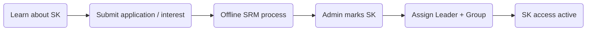

_Figure 2.3.3.1 – SwaRaj Kriya Application, Approval & Eligibility high-level flow_

### 2.3.5 Functional Flow

#### 2.3.5.1 Prospective user applies

1. User opens the SwaRaj Kriya introduction.

2. User reviews the supplied information and submits the agreed form.

3. The application creates an Admin-visible & Swaraj Kriya sub-admin-visible record.

4. SRM continues the evaluation/training process offline.

5. After submitting, the Apply button is replaced by View Status of SwaRaj Kriya. Selecting it shows the status of the application.

6. Free and Premium users reach this page as their landing page according to the usage count (2.4.5.1)

#### 2.3.5.2 Admin activates practitioner

1. Admin locates the user after successful offline completion.

2. Admin confirms that the user’s payment for SwaRaj Kriya access is confirmed (online, or offline with the Admin marking the status).

3. Admin checks the user’s eligibility for the programme and marks the user as a SwaRaj Kriya participant.

4. Admin assigns the programme, the Kriya Leader and the group.

5. The system updates access and sends the configured approval communication.

### 2.3.8 User Permissions

#### 2.3.8.1 Role Definitions

Guest/Registered User as prospective participant; Admin as verifier; Kriya Leader as assigned guide.

#### 2.3.8.2 Allowed Operations

- Prospective user may view introduction and submit the agreed application.

- User may view the status of their application.

- Admin and Swaraj Kriya Admin may review, approve/mark, assign the programme, assign the Kriya Leader and assign the group.

#### 2.3.8.3 Restricted Operations

- User cannot self-approve or self-assign Leader/group.

- Kriya Leader cannot independently grant SK entitlement unless separately authorized in the Admin model.

### 2.3.10 User Stories

#### 2.3.10.1 Apply for SwaRaj Kriya

| **Story ID** | US-SKON-01 |
|---|---|
| **Primary Actor(s)** | Guest / Registered User |
| **User Story** | As a prospective practitioner, I want to understand SwaRaj Kriya and submit my interest/application so that SRM can take me through the eligibility process. |
| **Acceptance Criteria** | • Introduction is available. • A valid submission creates an Admin-visible record. • After applying, the user sees View Status of SwaRaj Kriya instead of Apply, and can view the status of the application. • The user is not automatically granted SK access. |
| **Exception Scenarios** | • Open application -> the user sees View Status instead of Apply, and a duplicate application is not created. |
| **Dependencies** | • Final form fields and status model. |

#### 2.3.10.2 Activate an approved practitioner

| **Story ID** | US-SKON-02 |
|---|---|
| **Primary Actor(s)** | Admin |
| **User Story** | As an Admin, I want to mark a completed user as an SK participant and assign the appropriate Leader/group so that the user can begin practice. |
| **Acceptance Criteria** | • SK status is activated. • Leader and Sk group are assigned. • The user receives the welcome notification first then the SK experience on the next entitlement refresh. • A programme, Kriya Leader and group are assigned at approval. |
| **Exception Scenarios** | •programme, Leader or group missing -> approval is blocked. |
| **Dependencies** | ~~• Leader/group master data.~~ ~~• Approval communication configuration.~~ |

### 2.3.12 Validation Rules

#### 2.3.12.2 Business Rules

- Only authorized Admin users may grant SK entitlement.

- The assigned Leader/group must be valid and active when required.

- A user already holding SK entitlement cannot create duplicate activation records.

- A practitioner has one programme at a time.

- A programme is assigned at approval and can be changed by Admin with a reason. Every change is recorded in the programme history.

- An inactive programme cannot be assigned.

### 2.3.13 Dependencies

- Final application fields.

- Leader/group operating model.

- WhatsApp approval communication method.

- Offline process outcome supplied by SRM.

### 2.3.14 Acceptance Testing Scenarios

#### 2.3.14.1 Core Functionality Testing

| **Test ID** | **Scenario** | **Expected Result** |
|---|---|---|
| TC-SKON-001 | Prospective user submits valid application | Admin-visible record is created. |
| TC-SKON-002 | User opens SwaRaj Kriya after submitting an application | View Status of SwaRaj Kriya is shown instead of Apply. Selecting it shows the status of the application. |
| TC-SKON-003 | Admin marks completed user as SK and assigns Leader/group | SK access becomes active with correct mapping. |
| TC-SKON-004 | Activated user reopens app | SK Home becomes available. |
| TC-SKON-005 | Approval communication is enabled | Configured approval message is triggered after activation. |

#### 2.3.14.4 Edge Cases

| **Test ID** | **Scenario** | **Expected Result** |
|---|---|---|
| TC-SKON-006 | Admin attempts activation without required Leader/group | System prevents incomplete mapping or flags it according to approved rule. |
| TC-SKON-007 | Assigned Leader is inactive | Assignment is refused and another active Leader is required. |

### 2.3.15 Assumptions

- SRM remains responsible for the offline eligibility/training process.

### 2.3.16 Constraints

- •Application form fields, approval statuses, programme definitions and eligibility criteria require final confirmation from SRM.

## 2.4 Home & Access-Based Experience

### 2.4.1 Module Overview

#### 2.4.1.1 Purpose

To present a simple Home experience appropriate to the user’s current access state, with clear priority for SwaRaj Kriya practice where applicable.

#### 2.4.1.2 Scope

In scope: pre-login entry with welcome and free content, landing page by access (Explore for users without SwaRaj Kriya access, SwaRaj Kriya for SwaRaj Kriya users) .

#### 2.4.1.3 Target Users

Guest, Registered User, Premium Subscriber, SwaRaj Kriya User, Kriya Leader.

#### 2.4.1.4 High-Level Functionality

The Home experience changes according to the user types. Guests land on Explore. SK users land on Explore when SK is completed, and on SK content when SK is not completed. Free and Premium users land on Apply for SwaRaj Kriya or Explore, depending on their usage count.

#### 2.4.1.5 Application Channel

| **Channel** | **Applicable?** | **Notes** |
|---|---|---|
| Web | No | No end-user web application in the current release. |
| Mobile (iOS/Android) | Yes | Primary Home experiences and access-based navigation. |

### 2.4.2 Key Characteristics

#### 2.4.2.1 Functional Capabilities

- Present the welcome content, free content (blogs/audio) before login.

- Present a logged-in content Home based on free/premium entitlement.

- Open the landing page by user type, as described in 2.4.5.1.

- Provide access to Practice, My Kriya, Explore, Profile and applicable supporting content.

- Use simple, native-feeling navigation and platform-appropriate controls.

- Keep key actions easy to discover for older/non-technical users.

#### 2.4.2.3 Operational Rules

- Events are excluded from the Phase 1 and must not be shown as an active Phase 1 destination.

- Home content is filtered by access. Premium items are shown with a lock and a Subscribe prompt to users without an active subscription. SwaRaj Kriya practice features are not displayed to users without SwaRaj Kriya access, who see the SwaRaj Kriya summary page instead.

- SK Home should prioritize practice over promotional/content modules.

- Final visual tokens/brand treatment are subject to approved design and brand guidance.

- The landing page is decided by user type, as described in 2.4.5.1.

#### 2.4.2.4 Users and their access

| **Access** | **Guest (not logged in / unregistered)** | **Registered User** | **Premium Subscriber** | **SwaRaj Kriya User** |
|---|---|---|---|---|
| Landing page | Explore | Explore | Explore | SwaRaj Kriya if SK not completed/ Explore if SK is completed |
| Welcome content and login screen | Yes | No | No | No |
| Free content | Browse | Yes | Yes | Yes |
| Premium content | Locked, with registration/subscription path | Locked, with Subscribe prompt | Yes | Yes (with active subscription) |
| SwaRaj Kriya introduction / summary | Yes | Yes | Yes | Not needed |
| Apply / View Status of SwaRaj Kriya | See section 4 | Yes | Yes | No |
| SwaRaj Kriya practice, My Kriya, programme and Kriya Leader | No | No | No | Yes |
| Bookmarks | No | Yes | Yes | Yes |
| Offline downloads (Practice and Explore audio) | Not decided | According to entitlement | According to entitlement | According to entitlement (SwaRaj Kriya audio is not listed under Downloads) |
| Profile, subscription and payments | No (guided to register) | Yes | Yes (renewal) | Yes (renewal) |

### 2.4.3 Flow Diagrams

#### 2.4.3.1 Home & Access-Based Experience Flow

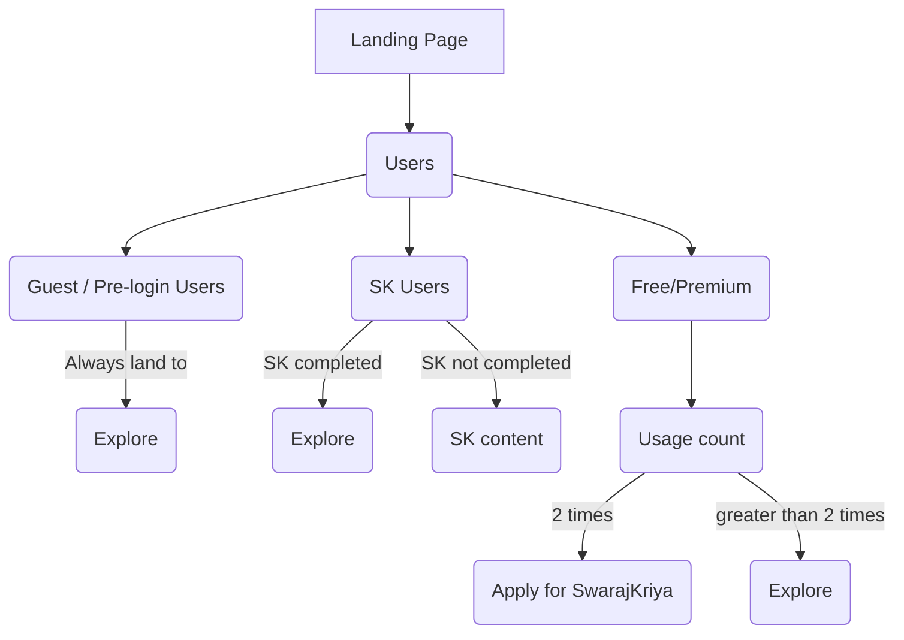

_Figure 2.4.3.1 – Home & Access-Based Experience high-level flow._

### 2.4.5 Functional Flow

#### 2.4.5.1 Resolve Home

- Guest / pre-login users always land on Explore.

- SK users land on Explore when SK is completed. When SK is not completed, they land on SK content.

- Free and Premium users land on Apply for SwaRaj Kriya when the usage count is 2 times. When it is greater than 2 times, they land on Explore.

#### 2.4.5.2 Start Kriya from Home

1. SK user opens Home.

2. Current practice and download/readiness state are displayed prominently.

3. User proceeds to download/start the Kriya flow.

### 2.4.8 User Permissions

#### 2.4.8.1 Role Definitions

Guest, Registered User, Premium Subscriber, SwaRaj Kriya User, Kriya Leader.

#### 2.4.8.2 Allowed Operations

- Guest may browse free content.

- Logged-in users may access content allowed by entitlement.

- SK user may access daily Kriya and supporting SK modules.

#### 2.4.8.3 Restricted Operations

- Non-SK users cannot access the SK practice Home.

- Content not configured for the user state cannot be opened.

### 2.4.10 User Stories

#### 2.4.10.1 See the right Home for my access

| **Story ID** | US-HOME-01 |
|---|---|
| **Primary Actor(s)** | Guest / Registered / Premium / SK User |
| **User Story** | As a user, I want the Home screen to match what I can actually use so that the application remains simple. |
| **Acceptance Criteria** | • Pre-login, logged-in and SK experiences are distinguishable. • Only entitled destinations are actionable. • The landing page depends on the user type. Guests land on Explore. SK users land on Explore when SK is completed, and on SK content when SK is not completed. Free and Premium users land on Apply for SwaRaj Kriya or Explore, depending on their usage count. |
| **Exception Scenarios** | • Entitlement cannot be resolved -> safest restricted experience is shown. |
| **Dependencies** | • Access model and content configuration. |

#### 2.4.10.2 Start daily practice easily

| **Story ID** | US-HOME-02 |
|---|---|
| **Primary Actor(s)** | SwaRaj Kriya User |
| **User Story** | As an SK practitioner, I want the day’s practice to be the most prominent action so that I can begin with minimal steps. |
| **Acceptance Criteria** | • Current Kriya is clearly visible. • Download/readiness status is shown. • Supporting content does not compete with the practice action. |
| **Exception Scenarios** | • Current Kriya is unavailable -> clear unavailable state is shown. |
| **Dependencies** | • Daily Kriya publication. |

### 2.4.12 Validation Rules

#### 2.4.12.2 Business Rules

- Home state must be resolved from server-authoritative access information when online.

- Protected destinations must recheck access when opened.

### 2.4.13 Dependencies

- Access module.

- Daily Kriya content module.

- Explore/Practice modules.

- Approved UI design.

### 2.4.14 Acceptance Testing Scenarios

#### 2.4.14.1 Core Functionality Testing

| **Test ID** | **Scenario** | **Expected Result** |
|---|---|---|
| TC-HOME-001 | Guest opens the App | Explore opens, with welcome content and free content. |
| TC-HOME-002 | Free user, usage count 2 times | Apply for SwaRaj Kriya opens. |
| TC-HOME-003 | Free user, usage count greater than 2 times | Explore opens. |
| TC-HOME-004 | Premium user, usage count 2 times, and greater than 2 times | Same results as TC-HOME-002 and TC-HOME-003. |
| TC-HOME-005 | SK user with SK completed opens the app/ SK user with SK not completed opens the app | Explore opens/ SK content opens. |
| TC-HOME-TBD | Kriya Leader without SwaRaj Kriya access logs in | Explore opens as the landing page. |
| TC-HOME-TBD | SK user reopens the app with a valid session | SwaRaj Kriya opens without an OTP. |
| TC-HOME-TBD | A registered user is approved for SwaRaj Kriya | The landing page changes to SwaRaj Kriya at the next access refresh. |

#### 2.4.14.4 Edge Cases

| **Test ID** | **Scenario** | **Expected Result** |
|---|---|---|
| TC-HOME-006 | Home content API unavailable | Available cached/local content is shown where permitted; protected access is not expanded. |
| TC-HOME-007 | Current Kriya not published | SK Home shows a clear unavailable state without crashing. |

### 2.4.15 Assumptions

- Final content ordering is finalized through UI/UX sign-off.

### 2.4.16 Constraints

- Which content is free is configured by Admin.

## 2.5 SwaRaj Kriya Content & Offline Media

### 2.5.1 Module Overview

#### 2.5.1.1 Purpose

To make the required SwaRaj Kriya media available for practice.

#### 2.5.1.2 Scope

In scope: daily/current Kriya media availability, automatic replacement of outdated Kriya audio.

#### 2.5.1.3 Target Users

SwaRaj Kriya User; Admin publishes/manages content.

#### 2.5.1.4 High-Level Functionality

SwaRaj Kriya audio required for offline practice is stored locally. Updated Kriya audio replaces outdated versions automatically. General videos remain online only

#### 2.5.1.5 Application Channel

| **Channel** | **Applicable?** | **Notes** |
|---|---|---|
| Web | Yes | Admin publishing/management surface only. |
| Mobile (iOS/Android) | Yes | Readiness, & offline use |

### 2.5.2 Key Characteristics

#### 2.5.2.1 Functional Capabilities

- Expose the current Kriya content to entitled SK users.

- Provide two Auto-play albums, Roohaniyat and Sri Guru’s voice, to help the user calm and prepare the mind before SwaRaj Kriya. Selecting an album plays a random track from it, and the tracks then play on continuously. Album audio is available for offline playback. The user exits the audio and starts SwaRaj Kriya manually.

- Record any disruption during the SwaRaj Kriya track (such as receiving  a call, or exiting or minimizing the app) as an interruption, and do not count that session.

- Do not record disruptions during Auto-play audio as interruptions. They have no effect on the count.

- SwaRaj Kriya audio for offline/Airplane Mode use.

- Automatically replace outdated Kriya audio when an updated version is published.

- Remove local application content when the application is uninstalled.

- Updating the application to a newer version shall not result in the loss, deletion, or alteration of existing downloaded content or locally stored database records. The application shall preserve the existing local media files and user data across application upgrades

- The SwaRaj Kriya audio provided to a practitioner follows the assigned programme.

#### 2.5.2.3 Operational Rules

- Videos remain online because of <mark>space</mark> considerations.

- Updated SK audio should replace outdated SK audio automatically

- SwaRaj Kriya audio is played from the SwaRaj Kriya section only and does not appear in the Downloads section.

### 2.5.3 Flow Diagrams

#### 2.5.3.1 SwaRaj Kriya Content & Offline Media Flow

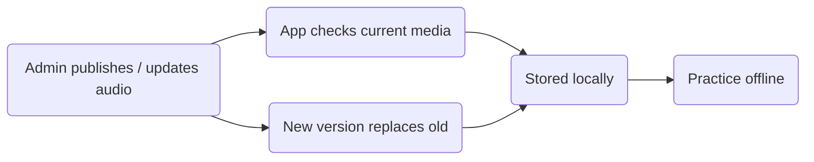

_Figure 2.5.3.1 – SwaRaj Kriya Content & Offline Media high-level flow_

### 2.5.5 Functional Flow

#### 2.5.5.1 Replace outdated Kriya audio

1. Admin publishes an updated Kriya audio version.

2. When the app next synchronizes, the new version is identified.

3. The updated audio replaces the outdated Kriya version.

### 2.5.8 User Permissions

#### 2.5.8.1 Role Definitions

SwaRaj Kriya User; Admin publishes/manages content.

#### 2.5.8.2 Allowed Operations

- Admin and Swaraj Kriya Admin can upload, replace and retire SwaRaj Kriya tracks. The SwaRaj Kriya User may play the tracks downloaded to the device.

#### 2.5.8.3 Restricted Operations

- Content Admin and other sub-admins cannot upload or change SwaRaj Kriya tracks.

### 2.5.10 User Stories

#### 2.5.10.1 Use Kriya audio offline

| **Story ID** | US-MEDIA-01 |
|---|---|
| **Primary Actor(s)** | SwaRaj Kriya User |
| **User Story** | As a SwaRaj Kriya User, I want the required Kriya audio to be available automatically for offline use so that I can perform SwaRaj Kriya even when internet connectivity is unavailable or the device is in Airplane Mode. |
| **Acceptance Criteria** | • Locally available Kriya audio can be played in Offline and Airplane Mode. • The application identifies whether the required current Kriya audio is available before the session starts. • The user is not required to manage the Kriya media manually. |
| **Exception Scenarios** | • Required Kriya audio is not available locally and internet connectivity is unavailable→the application shows a clear message and the session cannot start until the required content becomes available. • Local media becomes unavailable or corrupted→the application retrieves the valid content again when connectivity is available. |
| **Dependencies** | • Offline media synchronization mechanism. • Local storage management rules. |

#### 2.5.10.2 Receive updated Kriya audio

| **Story ID** | US-MEDIA-02 |
|---|---|
| **Primary Actor(s)** | SwaRaj Kriya User / Admin |
| **User Story** | As a practitioner, I want updated Kriya audio to replace outdated versions so that I always practise with the current approved content. |
| **Acceptance Criteria** | • New version is detected when synchronization is possible. • Old Kriya version is replaced. |
| **Exception Scenarios** | • Update fails -> existing valid local version remains available until the approved replacement is ready, subject to final publication rule. |
| **Dependencies** | • Versioning/publication rule. |

### 2.5.12 Validation Rules

#### 2.5.12.2 Business Rules

- Only entitled users will retrieve Kriya media.

### 2.5.13 Dependencies

- Media hosting will be done by ~~vimeo.~~ <mark>Mux</mark>

- Admin publication workflow.

### 2.5.14 Acceptance Testing Scenarios

#### 2.5.14.1 Core Functionality Testing

| **Test ID** | **Scenario** | **Expected Result** |
|---|---|---|
| TC-MEDIA-001 | Enable Airplane Mode and start Kriya | Local audio remains playable. |
| TC-MEDIA-002 | Admin publishes updated Kriya audio | App recognizes the update and replaces outdated Kriya audio when synchronized. |
| TC-MEDIA-003 | Uninstall the application | Application-owned local content is removed by the platform/app lifecycle. |

#### 2.5.14.4 Edge Cases

| **Test ID** | **Scenario** | **Expected Result** |
|---|---|---|
| TC-MEDIA-001 | Media host unavailable | Existing valid local Kriya remains usable and incident gets logged |

### 2.5.15 Assumptions

- Audio is the confirmed offline media type.

- Two auto play albums (Roohaniyat & Sri Guru's Voice) will be available for SwaRaj Kriya users. Upon selecting an album, the system will randomly initiate playback of an audio or video available within the selected album. This content will be available for offline playback

### 2.5.16 Constraints

- The offline functionality applicable to Swaraj Kriya audio shall not be extended to video content.

## 2.6 SwaRaj Kriya Session Execution & Playback

### 2.6.1 Module Overview

#### 2.6.1.1 Purpose

To deliver the guided SwaRaj Kriya session with a deliberately restricted control set and reliable behaviour in online, offline and Airplane Mode.

#### 2.6.1.2 Scope

In scope: pre-practice Airplane Mode guidance, session start, restricted playback controls, completion/exit, local session-state capture and integration with count tracking. ~~Resume/restart semantics after exit are still open.~~

#### 2.6.1.3 Target Users

SwaRaj Kriya User; Kriya Leader only if they are also permitted to practise as an SK user. ~~, subject to final role confirmation.~~

#### 2.6.1.4 High-Level Functionality

The practitioner uses the approved Kriya media and starts a focused session. During an active Kriya, normal pause/play/seek controls are not available. Session data  is captured locally so the experience can continue without connectivity.

#### 2.6.1.5 Application Channel

| **Channel** | **Applicable?** | **Notes** |
|---|---|---|
| Web | No | Kriya practice is mobile-only. |
| Mobile (iOS/Android) | Yes | Entire Kriya session experience. |

### 2.6.2 Key Characteristics

#### 2.6.2.1 Functional Capabilities

- Present an advisory prompt to enable Airplane Mode before practice.

- Start the Kriya using locally available media where required.

- Hide normal pause/play and seek controls during active Kriya.

- Allow the practitioner to complete or exit the session.

- Capture session start/end/completion/exit information locally.

- Operate without continuous API connectivity once required media is locally available.

- Start time and completion time will be visible to his leader and admin for each user.

- SwaRaj Kriya Extended: extended practice sessions are available to practitioners whose programme includes them.

#### 2.6.2.3 Operational Rules

- Airplane Mode support is required; the app must not depend on a continuous network connection during practice.

- No standard pause/play/seek controls are presented during active Kriya.

- Once the user exits the application or leaves an ongoing session, the session cannot be resumed from the point of interruption. The user must initiate a new session if they wish to continue.

### 2.6.3 Flow Diagrams

#### 2.6.3.1 SwaRaj Kriya Session Execution & Playback Flow

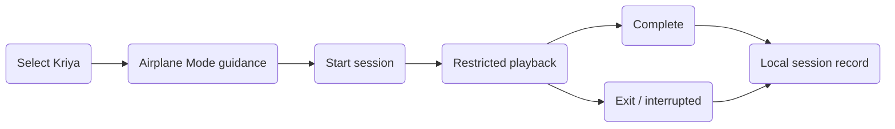

_Figure 2.6.3.1 – SwaRaj Kriya Session Execution & Playback high-level flow_

### 2.6.5 Functional Flow

#### 2.6.5.1 Complete a session

1. User selects the current Kriya.

2. App shows Airplane Mode guidance.

3. Session starts using the approved local/online media path.

4. Restricted player runs without normal pause/seek controls.

5. On completion, the session event is stored locally and the post-Kriya flow is presented.

#### 2.6.5.2 Exit a session

1. The user explicitly exits the application, navigates away using the defined back action, or leaves the application through device-level actions such as minimizing, closing, or force-stopping the application.

2. The app records an interruption/session event locally.

3. The next allowed action (resume or restart) follows the final business rule once confirmed.

4. After the Kriya is completed, the user should get the prompt to give feedback on how his Kriya was.

### 2.6.8 User Permissions

#### 2.6.8.1 Role Definitions

SwaRaj Kriya User; Kriya Leader only if they are also permitted to practise as an SK user, subject to final role confirmation.

#### 2.6.8.2 Allowed Operations

- SK user may start, complete and exit the Kriya.

#### 2.6.8.3 Restricted Operations

- Non-SK users cannot start protected Kriya.

- User cannot seek or use normal pause/play controls during active Kriya.

### 2.6.10 User Stories

#### 2.6.10.1 Practise in Airplane Mode

| **Story ID** | US-KRIYA-01 |
|---|---|
| **Primary Actor(s)** | SwaRaj Kriya User |
| **User Story** | As a practitioner, I want the Kriya to continue without network connectivity so that server or network issues do not interrupt my practice. |
| **Acceptance Criteria** | • Required media is available locally before practice where needed. • Session can continue in Airplane Mode. • Activity is stored locally for later synchronization. |
| **Exception Scenarios** | • Required media is not available locally and network is unavailable -> session cannot start and clear guidance is shown. |
| **Dependencies** | • Offline media and count tracking modules. |

### 2.6.12 Validation Rules

#### 2.6.12.2 Business Rules

- Only active SK entitlement may start a Kriya session.

- Completion status must be based on the defined session/completion rule.

- Session events must be associated with the active user profile.

### 2.6.13 Dependencies

- Offline media readiness.

- Final completion/count rule.

- Final resume/restart rule.

### 2.6.14 Acceptance Testing Scenarios

#### 2.6.14.1 Core Functionality Testing

| **Test ID** | **Scenario** | **Expected Result** |
|---|---|---|
| TC-KRIYA-001 | Start Kriya | Session starts successfully. |
| TC-KRIYA-002 | Run session in Airplane Mode | Playback continues and local activity is captured. |
| TC-KRIYA-003 | Observe active controls | No normal pause/play/seek controls are available. |
| TC-KRIYA-004 | Complete session | Completion event is stored for count/reporting. |
| TC-KRIYA-005 | Exit session | Interruption/session event is stored and next-step behaviour follows approved rule. |

#### 2.6.14.4 Edge Cases

| **Test ID** | **Scenario** | **Expected Result** |
|---|---|---|
| TC-KRIYA-006 | App is killed during an active session | Session resolves according to final interruption rule without fabricating completion. |
| TC-KRIYA-007 | Server becomes unavailable mid-session | Practice continues from local media; synchronization waits. |

### 2.6.15 Assumptions

- Kriya session logging must never block playback.

### 2.6.16 Constraints

- If the user locks the device or switches off the phone during an active Kriya session, the session shall be considered closed/terminated. The user shall not be able to resume the interrupted session from the point where it was stopped and must start a new session.

## 2.7 Offline Count Tracking & Two-Way Synchronization

### 2.7.1 Module Overview

#### 2.7.1.1 Purpose

To preserve accurate SwaRaj Kriya activity and counts across Online, Offline and Airplane Mode and synchronize them with the backend without mixing users or double-counting.

#### 2.7.1.2 Scope

In scope: local event persistence, local count visibility, synchronization to backend, backend-to-app count updates, retry/pending state, user-profile isolation and data-loss edge cases. Exact trigger/conflict algorithm remains a technical design item.

#### 2.7.1.3 Target Users

SwaRaj Kriya User; Admin for backend count adjustments and reporting.

#### 2.7.1.4 High-Level Functionality

Each valid Kriya activity is captured as an event and stored locally before synchronization. When online, synchronization occurs promptly. In Offline/Airplane Mode, pending activity remains on-device and synchronizes once connectivity returns. Backend adjustments made by Admin must also synchronize back to the app.

#### 2.7.1.5 Application Channel

| **Channel** | **Applicable?** | **Notes** |
|---|---|---|
| Web | Yes | Admin may view/adjust approved count values and reporting through the Admin Portal. |
| Mobile (iOS/Android) | Yes | Local count visibility, offline event storage and synchronization. |

### 2.7.2 Key Characteristics

#### 2.7.2.1 Functional Capabilities

- Keep the current/previously synchronized Kriya count visible in Airplane Mode.

- Persist valid Kriya activity locally with timestamps (UTC time and the user’s reporting timezone)  before backend synchronization.

- Synchronize pending local activity to the backend after connectivity returns.

- Synchronize approved backend count changes back to the mobile application.

- Each synchronization exchanges the session record, count result, interruption data and post-Kriya feedback from the app, and the consolidated history, counts, Admin adjustments and programme details from the server.

- Prevent count mixing when different user profiles use the same device.

- Support retry after failed synchronization without inflating the count.

- Expose synchronization status for diagnostics/logging.

- There should be a minimum 8 hrs gap between 2 SKs.

#### 2.7.2.3 Operational Rules

- Repeated polling is not preferred; INT will define an optimized trigger-based synchronization approach. Synchronization is trigger-based, with no repeated polling. It runs when a session ends, when the app is opened or returns to the foreground (that is, when the user opens the Mobile Application with internet connectivity on ), when connectivity is restored,  and in the background when the operating system permits. Failed synchronizations are retried at the next trigger with increasing intervals.

- Practice data and pending records are stored locally in the application’s private storage on Android and iOS, separated by user ID. This storage is removed when the application is uninstalled or its data is cleared.

- Clearing application data before pending local events synchronize can permanently lose those unsynchronized events on that device.

- Server-side synchronized history remains intact even if local data is cleared or the app is reinstalled.

- User-specific counts/history must remain isolated by profile

- Admin-side count changes must be reflected on the app after synchronization.

- While app synchronization, the logs should be maintained on the server side.

- A session is counted when the SwaRaj Kriya track plays to the end without interruption.

- A week runs from Sunday 00:00 to Saturday 23:59:59 in the user’s reporting timezone. Month, quarter and year counts are also maintained. Quarter start and end dates are configured by Admin

- Each session is stored with the time in UTC and the user’s reporting timezone. The reporting timezone is fixed and set by the user.

- The weekly count is compared with the programme’s weekly target.

- Sessions beyond the programme’s weekly maximum are not counted.

- At least 8 hours must pass between two SwaRaj Kriya sessions. The outcome of a session started sooner is Clarification Required.

- When sessions from several devices are synchronized, the server evaluates them in the order of session time.

- Admin count adjustments are included in the counts.

### 2.7.3 Flow Diagrams

#### 2.7.3.1 Offline Count Tracking & Two-Way Synchronization Flow

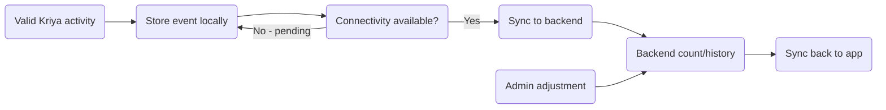

_Figure 2.7.3.1 – Offline Count Tracking & Two-Way Synchronization high-level flow_

### 2.7.5 Functional Flow

#### 2.7.5.1 Offline-to-online synchronization

1. A valid Kriya event is stored locally with user/session/timestamp information.

2. If connectivity is unavailable, the event remains pending.

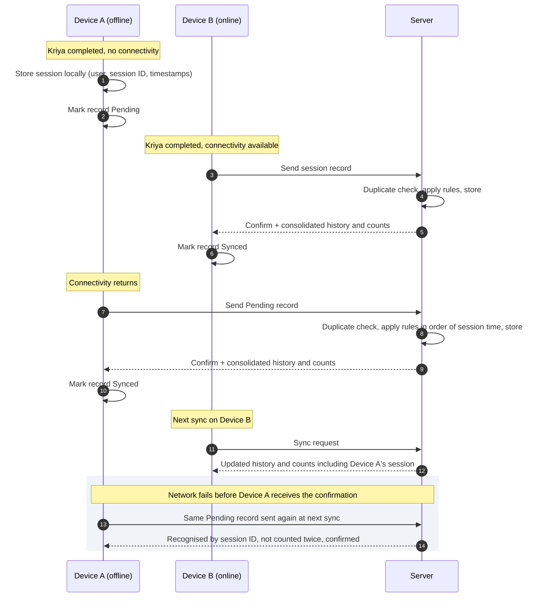

3. When connectivity returns, the app sends pending activity to the backend.

4. The app updates local status after the backend accepts the activity. If connectivity fails before the app receives the backend’s confirmation, the record remains Pending and is sent again at the next synchronization. The backend identifies a record it already holds by its session ID and does not count it again.

#### 2.7.5.2 Backend-to-app synchronization

1. Authorized Admin updates a user count where permitted.

2. Backend stores the approved adjustment.

3. The server holds the updated count/history state. Each of the user’s logged-in devices receives it the next time that device synchronizes.

### 2.7.8 User Permissions

#### 2.7.8.1 Role Definitions

SwaRaj Kriya User; Admin for backend count adjustments and reporting.

#### 2.7.8.2 Allowed Operations

- User may view own locally available count/history.

- Admin may perform approved backend count adjustment.

#### 2.7.8.3 Restricted Operations

- User cannot directly edit synchronized count records.

- Data from one profile cannot appear under another profile.

### 2.7.10 User Stories

#### 2.7.10.1 Keep my count while offline

| **Story ID** | US-SYNC-01 |
|---|---|
| **Primary Actor(s)** | SwaRaj Kriya User |
| **User Story** | As a practitioner, I want my Kriya activity saved locally when I am offline so that it can be counted when I reconnect. |
| **Acceptance Criteria** | • Event is stored locally before sync. • Count/history remains available from local data as designed. • Pending data syncs after connectivity returns. |
| **Exception Scenarios** | • App data is manually cleared before sync -> pending local-only events may be lost; server history remains intact. |
| **Dependencies** | • Final sync-trigger and conflict design. |

#### 2.7.10.2 Receive Admin count correction

| **Story ID** | US-SYNC-02 |
|---|---|
| **Primary Actor(s)** | Admin / SwaRaj Kriya User |
| **User Story** | As an Admin, I want an approved backend count correction to synchronize to the user’s device so that both sides show consistent information. |
| **Acceptance Criteria** | • Adjustment is recorded on backend. • App receives updated count after sync. • Change is not attributed to another profile. |
| **Exception Scenarios** | • Device remains offline -> the backend remains authoritative until the device’s next sync, and the sync date is recorded. |
| **Dependencies** | • Admin count adjustment rules. |

### 2.7.12 Validation Rules

#### 2.7.12.2 Business Rules

- Every locally stored event must be associated with the active user and a valid Kriya/session context.

- Synchronization retries must not create duplicate count increments.

- Backend is authoritative once an event/adjustment has synchronized.

- Synchronized practice history is removed from the device on a rolling basis. In December, the local records for January to June of the same year are deleted. In June, the local records for July to December of the previous year are deleted. History older than this stays on the server and is shown when the user is online.

- Records that have not yet been synchronized are never deleted.

### 2.7.13 Dependencies

- Final synchronization trigger/conflict strategy.

- Backend APIs for activity/count sync.

- Admin count-adjustment rule.

- Local history retention period.

- Programme definitions (weekly target and maximum for each programme), to be provided by SRM.

### 2.7.14 Acceptance Testing Scenarios

#### 2.7.14.1 Core Functionality Testing

| **Test ID** | **Scenario** | **Expected Result** |
|---|---|---|
| TC-SYNC-001 | Complete Kriya online | Activity synchronizes and backend count updates. |
| TC-SYNC-002 | Complete Kriya in Airplane Mode | Activity remains locally available/pending. |
| TC-SYNC-003 | Reconnect after offline activity | Pending activity synchronizes without duplication. |
| TC-SYNC-004 | Admin changes count on backend | Updated value reaches app on next synchronization. |
| TC-SYNC-005 | Different user signs into same device | Counts remain isolated per user profile. |

#### 2.7.14.4 Edge Cases

| **Test ID** | **Scenario** | **Expected Result** |
|---|---|---|
| TC-SYNC-006 | Clear app data before pending sync | Unsynchronized local-only activity is lost; existing server data is restored after login/sync. |
| TC-SYNC-007 | Network drops during synchronization | Pending event remains retryable and does not double-count on retry. |

### 2.7.15 Assumptions

- Backend APIs support two-way count/activity exchange.

### 2.7.16 Constraints

- Exact sync triggers, conflict resolution and local retention period remain Pending Technical/SRM Confirmation.

## 2.8 Distraction & Interruption Tracking

### 2.8.1 Module Overview

#### 2.8.1.1 Purpose

To record and report user-initiated exits or interruptions (WhatsApp call only) during active SwaRaj Kriya without misclassifying technical/system events.

#### 2.8.1.2 Scope

In scope: explicit exit/back events, per-session interruption count, reporting to user/Admin and synchronization. Treatment of app kill, call, crash, OS interruption and other technical causes remains open.

#### 2.8.1.3 Target Users

SwaRaj Kriya User as data subject; Admin for monitoring/reporting.

#### 2.8.1.4 High-Level Functionality

The application records deliberate exits/back actions during active Kriya as interruption events. These are linked to the user and session and synchronized with the backend. Technical events that should or should not count must be finalized before analytics are considered complete.

#### 2.8.1.5 Application Channel

| **Channel** | **Applicable?** | **Notes** |
|---|---|---|
| Web | Yes | Admin reporting surface. |
| Mobile (iOS/Android) | Yes | Event capture and user-facing analytics/history. |

### 2.8.2 Key Characteristics

#### 2.8.2.1 Functional Capabilities

- Record explicit Exit/Back during an active Kriya.

- Associate interruption with user, session and timestamp.

- Maintain an exact interruption count per session.

- Synchronize interruption events after offline use.

- Display interruption information within My Kriya/reporting.

- Keep technical/system interruptions distinguishable from user-initiated exits once taxonomy is confirmed.

#### 2.8.2.3 Operational Rules

- Explicit Exit/Back is the confirmed minimum interruption event.

- App kill, crash, incoming call, OS backgrounding, device restart and related cases require final classification.

- Interruption logging must not block or degrade the Kriya session.

### 2.8.3 Flow Diagrams

#### 2.8.3.1 Distraction & Interruption Tracking Flow

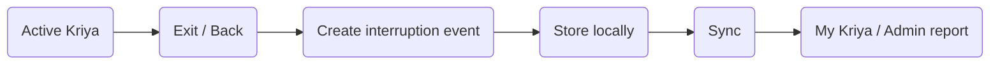

_Figure 2.8.3.1 – Distraction & Interruption Tracking high-level flow_

### 2.8.5 Functional Flow

#### 2.8.5.1 Record interruption

1. User is in an active Kriya.

2. User selects Exit/Back.

3. App records an interruption event against the session.

4. Event is stored locally and synchronized when possible.

#### 2.8.5.2 Review interruption

1. User/Admin opens the relevant report.

2. System aggregates confirmed interruption events for the selected period/session.

### 2.8.8 User Permissions

#### 2.8.8.1 Role Definitions

SwaRaj Kriya User as data subject; Admin for monitoring/reporting.

#### 2.8.8.2 Allowed Operations

- Admin may view/report permitted practitioner interruption data.

- Admin users can only see the application users  interruption data.

#### 2.8.8.3 Restricted Operations

- User cannot delete or edit interruption events.

- No user may view another user’s data without authorized Admin/role access.

### 2.8.10 User Stories

#### 2.8.10.1 Record my exits accurately

| **Story ID** | US-DIST-01 |
|---|---|
| **Primary Actor(s)** | SwaRaj Kriya User |
| **User Story** | As a practitioner, I want deliberate exits captured accurately so that my practice history reflects what happened. |
| **Acceptance Criteria** | • Each explicit exit/back records one event. • Event is tied to the correct session. |
| **Exception Scenarios** | • An interruption other than an explicit Exit/Back is recorded in its category (user-initiated, device-generated or technical) according to the agreed classification. |
| **Dependencies** | • Final interruption taxonomy. |

#### 2.8.10.2 Review interruption history

| **Story ID** | US-DIST-02 |
|---|---|
| **Primary Actor(s)** | Admin |
| **User Story** | As a user or Admin, I want interruption data included in reports so that practice patterns can be reviewed. |
| **Acceptance Criteria** | • Counts are visible for applicable periods. • Data is separated by user/session. |
| **Exception Scenarios** | • No data -> clear empty state is shown. |
| **Dependencies** | • My Kriya/reporting. |

### 2.8.12 Validation Rules

#### 2.8.12.2 Business Rules

- The event requires a valid active session and user.

- Duplicate synchronization must not inflate interruption count.

### 2.8.13 Dependencies

- Kriya session module.

- Offline synchronization.

- Final interruption taxonomy.

### 2.8.14 Acceptance Testing Scenarios

#### 2.8.14.1 Core Functionality Testing

| **Test ID** | **Scenario** | **Expected Result** |
|---|---|---|
| TC-DIST-001 | Exit once during active Kriya | Exactly one interruption event is recorded. |
| TC-DIST-002 | Exit multiple times according to approved session semantics | Each confirmed exit is counted correctly. |
| TC-DIST-003 | Complete Kriya without exit | No explicit-exit interruption is recorded. |
| TC-DIST-004 | ~~Record exit while offline and reconnect~~ | ~~Event synchronizes once.~~ |
| TC-DIST-005 | View interruption report | Correct user/session counts are shown. |

#### 2.8.14.4 Edge Cases

| **Test ID** | **Scenario** | **Expected Result** |
|---|---|---|
| TC-DIST-006 | Incoming call / OS interruption | Handled according to final taxonomy without arbitrary user-blame. |
| TC-DIST-007 | Sync retry occurs multiple times | Interruption count is not duplicated. |

### 2.8.15 Assumptions

- Explicit user Exit/Back remains the minimum confirmed tracked event.

### 2.8.16 Constraints

- Technical-interruption taxonomy remains Pending SRM Confirmation.

## 2.9 Post-Kriya Feedback & Emotional State

### 2.9.1 Module Overview

#### 2.9.1.1 Purpose

To capture the practitioner’s reflection after completed SwaRaj Kriya and optionally record reasons, notes and emotional state.

#### 2.9.1.2 Scope

In scope: Kriya rating, reason selection, optional note, emotional-state selection and optional sharing with SRM. Exact scales/categories and shared-note handling remain open.

#### 2.9.1.3 Target Users

SwaRaj Kriya User.

#### 2.9.1.4 High-Level Functionality

After a completed Kriya, the user can rate the experience, choose relevant reasons, add an optional note and indicate how they feel. The flow is intentionally simple and must never block the user from returning to the app.

#### 2.9.1.5 Application Channel

| **Channel** | **Applicable?** | **Notes** |
|---|---|---|
| Web | Yes | Admin may view applicable feedback/reports where permitted. |
| Mobile (iOS/Android) | Yes | Feedback capture after Kriya. |

### 2.9.2 Key Characteristics

#### 2.9.2.1 Functional Capabilities

- Capture “How was your Kriya today?” rating/slider.

- Offer the reasons set in the reason master

- Capture optional free-text note.

- Capture an emotional-state selection.

- Optionally share the feedback/note with SRM Team~~, subject to final process definition~~.

- Allow the user to skip feedback and continue.

#### 2.9.2.3 Operational Rules

- Feedback is associated with the relevant completed session.

- Reason options are shown when relevant to the selected rating/experience.

- ~~Sharing with SRM is optional and requires explicit user action.~~

- Exact emotional-state scale and operational handling of shared notes remain Pending SRM Confirmation.

### 2.9.3 Flow Diagrams

#### 2.9.3.1 Post-Kriya Feedback & Emotional State Flow

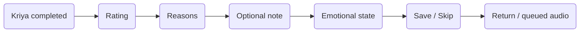

_Figure 2.9.3.1 – Post-Kriya Feedback & Emotional State high-level flow_

### 2.9.5 Functional Flow

#### 2.9.5.1 Submit post-Kriya feedback

1. Completed session opens the feedback flow.

2. User selects rating and applicable reasons.

3. User optionally adds a note and emotional state.

4. User saves or skips and returns to the next allowed destination.

### 2.9.8 User Permissions

#### 2.9.8.1 Role Definitions

SwaRaj Kriya User.

#### 2.9.8.2 Allowed Operations

- User may create feedback for own completed session.

- User may choose whether to share optional note/feedback with SRM.

#### 2.9.8.3 Restricted Operations

- User cannot view another user’s feedback.

### 2.9.10 User Stories

#### 2.9.10.1 Reflect after Kriya

| **Story ID** | US-FEED-01 |
|---|---|
| **Primary Actor(s)** | SwaRaj Kriya User |
| **User Story** | As a practitioner, I want to record how my Kriya felt so that I can review my practice over time. |
| **Acceptance Criteria** | • Rating can be saved against the completed session. • Relevant reasons and optional note can be captured. • Emotional state can be captured when the scale is finalized. |
| **Exception Scenarios** | • User skips -> session remains complete without a feedback record. |
| **Dependencies** | • Final rating/emotional-state definitions. |

#### 2.9.10.2 Optionally share a note

| **Story ID** | US-FEED-02 |
|---|---|
| **Primary Actor(s)** | SwaRaj Kriya User |
| **User Story** | As a practitioner, I want to choose whether my note is shared with SRM so that private reflections remain private unless I opt in. |
| **Acceptance Criteria** | • Sharing requires an explicit action. • Unshared note is not exposed as shared. |
| **Exception Scenarios** | • Dispatch/handling unavailable -> note remains stored according to final sharing process. |
| **Dependencies** | • SRM recipient/review process. |

### 2.9.12 Validation Rules

#### 2.9.12.2 Business Rules

- Feedback must reference the correct user/session.

- Share flag defaults to not shared.

- Final rating/emotional-state values must come from an approved configured set.

- Reason values come from a set configured by Admin.

### 2.9.13 Dependencies

- Kriya completion.

- Final rating/emotional-state scale.

- Shared-feedback operating process.

### 2.9.14 Acceptance Testing Scenarios

#### 2.9.14.1 Core Functionality Testing

| **Test ID** | **Scenario** | **Expected Result** |
|---|---|---|
| TC-FEED-001 | Complete Kriya | Feedback flow is offered. |
| TC-FEED-002 | Select poor experience | Reason options are available. |
| TC-FEED-003 | Save note and emotional state | Data is saved against the correct session. |
| TC-FEED-004 | Skip feedback | User proceeds without changing completion status. |
| TC-FEED-005 | Opt to share note | Share status is stored explicitly. |

#### 2.9.14.4 Edge Cases

| **Test ID** | **Scenario** | **Expected Result** |
|---|---|---|
| TC-FEED-006 | Feedback save fails while offline | Entry remains local/pending where supported and user is not forced to retype immediately. |
| TC-FEED-007 | No emotional-state value selected | Behaviour follows final mandatory/optional rule without invalid data. |

### 2.9.15 Assumptions

- Feedback remains optional unless SRM specifies otherwise.

### 2.9.16 Constraints

- Emotional-state scale and shared-note handling remain unresolved.

## 2.10 My Kriya, History & Reports

### 2.10.1 Module Overview

#### 2.10.1.1 Purpose

To provide practitioners and authorized administrators with meaningful practice history, count and reporting over standard time periods.

#### 2.10.1.2 Scope

In scope: practice count/history, completion/interruption data (WhatApp Call), feedback summaries, weekly/monthly/quarterly/yearly views, monthly/yearly reports and server-side complete history. ~~Final formulas for derived scores/adherence remain open.~~

#### 2.10.1.3 Target Users

SwaRaj Kriya User; Admin for authorized reporting.

#### 2.10.1.4 High-Level Functionality

The user can review practice history and counts using period-based views. Local data should support useful history even when offline, while the backend retains the complete record. Monthly and yearly reports are required, with additional weekly/quarterly views carried forward from earlier agreed discussions.

#### 2.10.1.5 Application Channel

| **Channel** | **Applicable?** | **Notes** |
|---|---|---|
| Web | Yes | Admin reports and exports. |
| Mobile (iOS/Android) | Yes | My Kriya history and user-facing analytics. |

### 2.10.2 Key Characteristics

#### 2.10.2.1 Functional Capabilities

- Display Kriya count and completed practice history.

- Display interrupted/incomplete sessions separately where data exists.

- Provide Week, Month, Quarter and Year views. Quarters follow the dates configured by Admin

- Provide monthly and yearly reporting with relevant application/practice data.

- Display feedback/rating history where applicable.

- Use synchronized server history as the complete authoritative record when online.

- Keep locally available history accessible in Offline/Airplane Mode according to the approved retention period.

- Show weekly progress against the programme target (for example, “4 of 5 sessions this week”).

- Mark each completed week as Target Met or Target Not Met.

- Show programme details.

#### 2.10.2.3 Operational Rules

- Exact local-history retention period is still open; “from January” and one-year retention were discussed in different notes.

- Server retains the complete synchronized tracking history.

- Derived KPIs such as Kriya Score, adherence %, streak or completion rate must not be implemented until formulas are approved.

- Adherence % is not shown until its formula is approved. This matches the line already there about derived scores.

### 2.10.3 Flow Diagrams

#### 2.10.3.1 My Kriya, History & Reports Flow

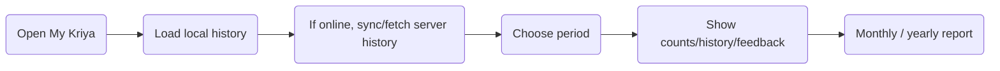

_Figure 2.10.3.1 – My Kriya, History & Reports high-level flow_

### 2.10.5 Functional Flow

#### 2.10.5.1 Review practice history

1. User opens My Kriya.

2. App loads available local history immediately.

3. If online, synchronized server history refreshes the view.

4. User selects Week, Month, Quarter or Year.

5. App displays the available practice metrics and history.

#### 2.10.5.2 Admin reporting

1. Admin chooses reporting period/filter and age group.

2. System retrieves synchronized backend data.

3. Monthly/yearly report is generated or exported according to the approved format.

### 2.10.8 User Permissions

#### 2.10.8.1 Role Definitions

SwaRaj Kriya User; Admin for authorized reporting.

#### 2.10.8.2 Allowed Operations

- User may view own practice/reporting data.

- Admin may view/export data permitted by role.

#### 2.10.8.3 Restricted Operations

- User cannot modify historical synchronized practice records.

### 2.10.10 User Stories

#### 2.10.10.1 Review my practice over time

| **Story ID** | US-MYK-01 |
|---|---|
| **Primary Actor(s)** | SwaRaj Kriya User |
| **User Story** | As a practitioner, I want to review my practice by time period so that I can understand my consistency. |
| **Acceptance Criteria** | • Week/Month/Quarter/Year views are available. • Counts and history correspond to the selected period. • Offline view uses locally available history. |
| **Exception Scenarios** | • No records -> a clear empty state is shown. |
| **Dependencies** | • Count sync and local retention rules. |

#### 2.10.10.2 Generate monthly/yearly report

| **Story ID** | US-MYK-02 |
|---|---|
| **Primary Actor(s)** | Admin |
| **User Story** | As an Admin, I want monthly and yearly reports so that SRM can review application and practice activity. |
| **Acceptance Criteria** | • Selected period generates the available relevant data. • Report uses backend synchronized history. |
| **Exception Scenarios** | • Incomplete sync -> report reflects backend-known data and does not invent missing local-only activity. |
| **Dependencies** | • Reporting field list and export format. |

### 2.10.12 Validation Rules

#### 2.10.12.2 Business Rules

- Report period must be valid.

- User-facing history must be filtered to the signed-in user.

- Derived metrics require approved formulas.

### 2.10.13 Dependencies

- Offline sync/count module.

- Feedback module.

- Final local retention period.

- Final report field list.

### 2.10.14 Acceptance Testing Scenarios

#### 2.10.14.1 Core Functionality Testing

| **Test ID** | **Scenario** | **Expected Result** |
|---|---|---|
| TC-MYK-001 | Open My Kriya online | Latest synchronized history is shown. |
| TC-MYK-002 | Open My Kriya in Airplane Mode | Locally retained history is shown. |
| TC-MYK-003 | Switch Week/Month/Quarter/Year | Data updates to the selected period. |
| TC-MYK-004 | Generate monthly report | Relevant synchronized data is returned. |
| TC-MYK-005 | Generate yearly report | Relevant synchronized annual data is returned. |

#### 2.10.14.4 Edge Cases

| **Test ID** | **Scenario** | **Expected Result** |
|---|---|---|
| TC-MYK-006 | Local history is older than retention window | Only retained local data is shown offline; server history returns when online. |
| TC-MYK-007 | Pending unsynchronized activity exists | Local view may include pending activity; backend report remains based on synchronized data until sync completes. |

### 2.10.15 Assumptions

- ~~Monthly/yearly reporting format will be agreed during design/UAT. Monthly/yearly reporting will be sent via whatsapp notification.~~

- Monthly, quarterly and yearly SwaRaj Kriya reports are sent as WhatsApp notifications. Once the user receives the notification, the user goes to the SK report section.

### 2.10.16 Constraints

- ~~Local retention period and formulas for any derived score/adherence remain open.~~ <mark>The weekly calculation shall start from Sunday, with the system applying the defined counting logic while considering the applicable user/local timezone for accurate calculation across different time zones.</mark>

## 2.11 Practice, Audio & Bookmarks

### 2.11.1 Module Overview

#### 2.11.1.1 Purpose

To provide supporting spiritual/practice audio separate from the daily SwaRaj Kriya and allow users to save/bookmark and use approved audio offline.

#### 2.11.1.2 Scope

In scope: Practice topics/tracks, audio playback, search/browse, bookmark, download of approved audio/practice tracks, local deletion and queued audio. Exact entitlement by user category remains configurable/pending.

#### 2.11.1.3 Target Users

Registered User, Premium Subscriber, SwaRaj Kriya User, depending on content entitlement; Admin manages content.

#### 2.11.1.4 High-Level Functionality

Users can browse Practice/audio content by topic, play it using standard media controls, bookmark items and download approved audio for offline use. Practice/audio content can be available offline, while videos remain online.

#### 2.11.1.5 Application Channel

| **Channel** | **Applicable?** | **Notes** |
|---|---|---|
| Web | Yes | Admin content management only. |
| Mobile (iOS/Android) | Yes | Browse, play, bookmark, download approved audio and manage downloads. |

### 2.11.2 Key Characteristics

#### 2.11.2.1 Functional Capabilities

- Browse Practice topics/categories and audio tracks.

- Share a Practice or Explore content item with others using a link.

- Search practice/audio content.

- Play non-Kriya audio with standard controls.

- Bookmark Practice content and view bookmarks.

- Download approved audio/practice tracks for offline use.

- Delete downloaded audio tracks.

- Use queued audio where configured after Kriya.

- Keep downloaded non-user-specific tracks available without mixing user-specific practice counts.

Access depends on how Admin has classified each item and on the user’s subscription:

- Free item: any logged-in user can open, play, bookmark and download it.

- Premium item: only a user with an active subscription can open it. This includes a SwaRaj Kriya user, who must hold an active subscription. During the grace period after expiry, access continues.

- Free user opening a Premium item: the item is shown with a lock and a Subscribe prompt. It is not played or downloaded.

- Not logged in: the user can view the welcome content and browse free content.

- Checked each time: access is re-checked whenever an item is opened, so a change to the user’s subscription or to the item’s classification applies at the next access check.

#### 2.11.2.3 Operational Rules

- Video remains online.

- ~~Offline entitlement for audio/practice tracks is now in scope and supersedes the earlier “Kriya-only download” assumption.~~

- Content in the SwaRaj Kriya, Practice and Explore sections is different. Practice and Explore audio can be downloaded for offline use, and the Downloads section has separate sections for Practice and Explore downloads. SwaRaj Kriya downloads are not shown in the Downloads section and are played from the SwaRaj Kriya section only.

- Bookmark is a saved reference and is independent of whether the audio is downloaded.

- Bookmarks are stored against the user’s account and are available on any device the user logs in on, and after the app is reinstalled. Uninstalling the app does not remove them.

- All Content under practice and the explore section should be shareable.

- Exact free/premium/SK entitlement per track is controlled by the final content-access matrix. Each content item will be configured by Admin as either Free or Premium, and this can be changed at any time. SwaRaj Kriya will not be a separate user type or content category. It will be a flag on the user’s account that enables access to the SwaRaj Kriya features only. SwaRaj Kriya approval requires an active subscription, so those users also have access to Premium content through their subscription.

- All views options like thumbnail, text of the content should be clickable.

- All content in the Practice and Explore sections can be shared. Sharing sends a link to the item and not the audio file. Opening the shared item always follows the recipient’s own access.

### 2.11.3 Flow Diagrams

#### 2.11.3.1 Practice, Audio & Bookmarks Flow

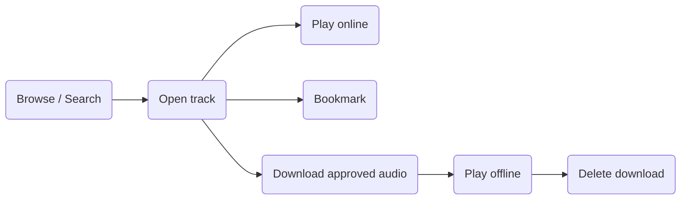

_Figure 2.11.3.1 – Practice, Audio (tracks and albums) & Bookmarks high-level flow_

### 2.11.5 Functional Flow

#### 2.11.5.1 Bookmark a practice item

1. User opens a practice track.

2. User selects Bookmark.

3. Reference is saved to the user’s bookmark list.

#### 2.11.5.2 Download and use audio offline

1. User opens an approved downloadable audio item.

2. User downloads the item with the download queue .

3. The file remains available offline until removed/expired by the approved rule.

4. User may delete the download manually.

5. In the Downloads section, downloaded audio is shown separately for Practice and Explore content. SwaRaj Kriya audio does not appear in the Downloads section and is played from the SwaRaj Kriya section only.

6. When multiple audios are downloaded together, they are queued and downloaded individually. Each file is marked available only after it has downloaded completely and passed an integrity check.

7. A partial or failed file is never playable. Files that completed stay available, and failed files are retried automatically when connectivity is available.

#### 2.11.5.3 Share content

- The user opens a Practice or Explore item and selects Share.

- The device’s share options open with the item’s link.

- The recipient taps the link.

- If the app is installed, it opens on that item. A user who is not logged in is asked to log in or sign up first.

- After login, the app checks access. A Free item opens. A Premium item opens only for a user with an active subscription. Otherwise the title is shown with a lock and a Subscribe prompt.

- If the app is not installed, the link opens the Play Store and  App Store page.

### 2.11.8 User Permissions

#### 2.11.8.1 Role Definitions

•Registered User, Premium Subscriber, SwaRaj Kriya User, depending on content entitlement; Admin manages content.

•Not logged in user can view the welcome screens and login screen ( if required along with some information or summary about Swaraj Kriya)  but cannot bookmark any audio or access any content from the application

#### 2.11.8.2 Allowed Operations

- User may play entitled content, bookmark, share (If the device is in online mode )and download items configured for offline use.

- A logged-in user may share any Practice or Explore item. Whether Guests may share is Clarification Required.

- Not logged in users can view the welcome screens and login screen and browse free content, but cannot bookmark any audio.

#### 2.11.8.3 Restricted Operations

- User cannot access premium/SK-only content without the required entitlement.

- Video download is not provided unless separately approved.

### 2.11.10 User Stories

#### 2.11.10.1 Bookmark practice content

| **Story ID** | US-PRAC-01 |
|---|---|
| **Primary Actor(s)** | Entitled User |
| **User Story** | As a user, I want to bookmark useful Practice content so that I can find it quickly later. |
| **Acceptance Criteria** | • Bookmark can be added/removed. • Bookmarked item appears in the dedicated list. |
| **Exception Scenarios** | • Content later becomes unavailable -> bookmark remains only if the final content-retention rule allows; access is still enforced. |
| **Dependencies** | • User identity and content entitlement. 1. Multiple devices: Bookmarks belong to the user's account and sync across all devices. Downloaded audio is stored on each device, so it is downloaded again on another device. 2. App update: Bookmarks are kept. Access is re-checked when the updated app opens. 3. Logout and Re login:  Bookmarks are restored at login. Other users on the same device do not see them. Access is re-checked before downloaded audio plays. |

#### 2.11.10.2 Use approved practice audio offline

| **Story ID** | US-PRAC-02 |
|---|---|
| **Primary Actor(s)** | Entitled User |
| **User Story** | As a user, I want approved Practice audio available offline so that I can listen without continuous connectivity. |
| **Acceptance Criteria** | • Download is offered only for eligible audio. • Downloaded audio plays offline. • User can remove the download. |
| **Exception Scenarios** | • Storage unavailable -> clear message is shown. |
| **Dependencies** | • Media hosting and offline entitlement configuration. |

### 2.11.12 Validation Rules

#### 2.11.12.2 Business Rules

- Bookmark must reference a valid content item and user.

- Download is allowed only when the content item is configured as downloadable and the user is entitled.

- A shared link never gives access to Premium content. Access is checked for each recipient when the link is opened.

- A shared Free item opens for any logged-in recipient.

- If the shared item has since been unpublished, the recipient sees “This content is no longer available.”

### 2.11.13 Dependencies

- Content management.

- Media hosting.

- Final entitlement matrix.

- Local storage rules.

### 2.11.14 Acceptance Testing Scenarios

#### 2.11.14.1 Core Functionality Testing

| **Test ID** | **Scenario** | **Expected Result** |
|---|---|---|
| TC-PRAC-001 | Search and open a Practice track | The correct item opens. •**Searchable Fields:** Search will be supported across both content title and description. •**Keyword Variations:** Search will support common spelling variations and closely matching keywords, such as _Guru Poornima_ and _Guru Purnima_. •**Result Loading:** Search results will be displayed using lazy loading. •**Content Type:** Users will be able to search audio and video content separately. •**Tag-Based Search:** Clarification Required on whether content tags will be included as searchable criteria. •**Result Sorting:** Search results will not have a configurable/specific sorting mechanism in the current scope. •**Protected Content:** Non-paid users will only be shown free content in the search results. |
| TC-PRAC-002 | Bookmark a Practice item | Item appears in bookmarks |
| TC-PRAC-003 | Un-bookmark of practice items | Item disappears in bookmarks |
| TC-PRAC-004 | Download eligible audio | Audio becomes available offline. |
| TC-PRAC-005 | Delete downloaded audio | Local file is removed. |
| TC-PRAC-006 | Open premium track without entitlement | Access is denied/purchase path shown. |

#### 2.11.14.4 Edge Cases

| **Test ID** | **Scenario** | **Expected Result** |
|---|---|---|
| TC-PRAC-006 | Switch user profiles on same device | Bookmarks remain user-specific; non-user-specific downloaded tracks may remain locally available subject to access checks. |
| TC-PRAC-007 | Downloaded item removed from catalogue | Access follows the approved withdrawal/retention rule; no unrelated downloads are removed. |
| TC-PRAC-008 | User type from free to paid or vice versa changes | **Subscribes:** after the payment is confirmed, the audio plays and downloads on all the user's devices at their next access check. **Expires:** Premium audio is locked and downloads stay in My Downloads but cannot be played, until renewal. |
| TC-PRAC-009 | Admin marks the video/audio as paid | Non-entitled users see the lock and subscribe prompt, and the audio is not streamed. Their downloaded copy is blocked and the item  is skipped in the practice queue. Premium Subscribers and practitioners see no change. The change goes for approval if made by a sub-admin. No new notification is sent. |
| TC-PRAC-010 | The video/audio is no more available | It disappears from listings and search. The bookmark shows "This content is no longer available." The downloaded copy is removed at the next synchronization. |

### 2.11.15 Assumptions

- Practice content taxonomy and metadata will be supplied/managed through Admin.

### 2.11.16 Constraints

- Final access entitlement and retention behaviour for withdrawn downloads remain open.

## 2.12 Explore SRM & Public/Premium Content

### 2.12.1 Module Overview

#### 2.12.1.1 Purpose

To provide a unified content-discovery experience for public, logged-in, premium and SK users without duplicating future website content management unnecessarily.

#### 2.12.1.2 Scope

In scope: free content for pre-login users , logged-in/premium content, audio/blogs/general information, video streaming, search/browse and Admin-configurable access. Events are deferred from Phase 1; website content synchronization is a future integration decision.

#### 2.12.1.3 Target Users

Guest, Registered User, Premium Subscriber, SwaRaj Kriya User.

#### 2.12.1.4 High-Level Functionality

Explore is the landing page for guests, for SK users whose SK is completed, and for Free and Premium users whose usage count is greater than 2 times.  Video streams online. Admin controls access classification. Explore is the landing page for users without SwaRaj Kriya access. Common website/app content may initially be managed separately, with centralized API-driven content management evaluated for a later phase.

#### 2.12.1.5 Application Channel

| **Channel** | **Applicable?** | **Notes** |
|---|---|---|
| Web | Yes | Existing website remains a separate content source; automated integration is future scope. |
| Mobile (iOS/Android) | Yes | Explore/browse/search/play/read experience. |

### 2.12.2 Key Characteristics

#### 2.12.2.1 Functional Capabilities

- Show the welcome content and free content before login.

- Show additional logged-in content after authentication.

- Show premium/SK-specific content according to entitlement.  Logged-in non paid users will be able to see the free  content only and non logged-in users will need to login to see the free content.

- Stream videos online, along with option to add youtube video

- Search/browse content by approved categories/tags.

- Allow Admin to configure whether content is public/free/premium/SK-specific.

- Present clear registration/subscription guidance for locked content.

#### 2.12.2.3 Operational Rules

- Which content is free is configured by Admin.

- SK holders should have access to applicable premium content .

- Events are deferred from the Phase 1.

- Long-term common website/app content should be evaluated for a single source of truth via API/integration; direct database coupling is not assumed.

### 2.12.3 Flow Diagrams

#### 2.12.3.1 Explore SRM & Public/Premium Content Flow

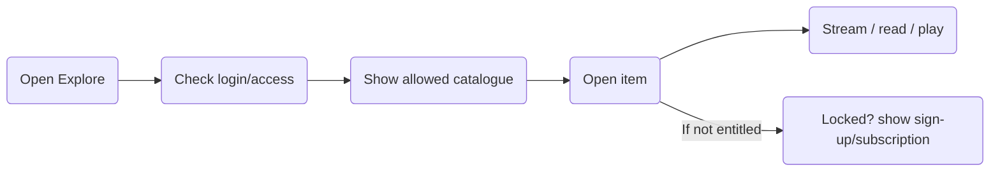

_Figure 2.12.3.1 – Explore SRM & Public/Premium Content high-level flow_

### 2.12.5 Functional Flow

#### 2.12.5.1 Explore before login

1. Guest opens Explore.

2. App shows welcome content and free content.

3. Locked content may show a clear registration/subscription path.

#### 2.12.5.2 Open premium/SK content

1. Authenticated user opens an item.

2. App checks applicable entitlement.

3. If allowed, content opens; otherwise, the approved access/purchase message is shown. Note - During the extended period the notification will be sent to the user on a daily basis.

### 2.12.8 User Permissions

#### 2.12.8.1 Role Definitions

Guest, Registered User, Premium Subscriber, SwaRaj Kriya User.

#### 2.12.8.2 Allowed Operations

- Guest may browse free content.

- Entitled users may access content allowed by their state.

#### 2.12.8.3 Restricted Operations

- Protected content cannot be opened solely because it appears in search/listing.

### 2.12.10 User Stories

#### 2.12.10.1 Explore before login

| **Story ID** | US-EXP-01 |
|---|---|
| **Primary Actor(s)** | Guest |
| **User Story** | As a visitor, I want to explore selected SRM content before registration so that I can understand the application and SwaRaj Kriya. |
| **Acceptance Criteria** | • Free content is available without login. • Protected content does not expose restricted media/data. |
| **Exception Scenarios** | • Public catalogue unavailable -> clear temporary-unavailable state is shown. |
| **Dependencies** | • Admin content-access configuration. |

#### 2.12.10.2 Access paid content

| **Story ID** | US-EXP-02 |
|---|---|
| **Primary Actor(s)** | Premium / SK User |
| **User Story** | As a paid user, I want entitled premium content to open without unnecessary friction. |
| **Acceptance Criteria** | • Entitlement is checked before protected content opens. • SK holder receives applicable premium access. • During the extended period, SK holders will only do the SwaRaj Kriya and cannot access the other premium content. |
| **Exception Scenarios** | • Entitlement expired -> access follows subscription/renewal rule. |
| **Dependencies** | • Payment/subscription module. |

### 2.12.12 Validation Rules

#### 2.12.12.2 Business Rules

- Every content item must have an approved access classification before publication.

- Protected content requires entitlement check.

### 2.12.13 Dependencies

- Content catalogue supplied by SRM.

- Admin content management.

- Payment/subscription access state.

- Future website content integration decision in future.

### 2.12.14 Acceptance Testing Scenarios

#### 2.12.14.1 Core Functionality Testing

| **Test ID** | **Scenario** | **Expected Result** |
|---|---|---|
| TC-EXP-001 | Guest opens free blog/audio | Content opens without login. |
| TC-EXP-002 | Guest opens protected item | Registration/subscription guidance shown; media not exposed. |
| TC-EXP-003 | A logged-in user without SwaRaj Kriya access opens the app | Explore opens as the landing page. |
| TC-EXP-004 | SK holder opens applicable premium content | Content opens per current direction. |
| TC-EXP-005 | Play a video | Video streams online. |

#### 2.12.14.4 Edge Cases

| **Test ID** | **Scenario** | **Expected Result** |
|---|---|---|
| TC-EXP-006 | Content access setting changes while user is active | Next access/refresh follows the updated setting. |
| TC-EXP-007 | Website and app copies differ during Phase 1 | App displays its configured source; automated cross-system reconciliation is not assumed. |

### 2.12.15 Assumptions

- Initial website/app content administration may remain separate.

### 2.12.16 Constraints

- Not Applicable

## 2.13 Payments, Subscription & Renewal

### 2.13.1 Module Overview

#### 2.13.1.1 Purpose

To support annual paid access through Razorpay and verified offline payments, maintain subscription state and handle renewal reminders/grace rules.

#### 2.13.1.2 Scope

In scope: Razorpay online payment, manual/offline payment update by Admin, subscription activation/status/history, annual renewal and invoice/receipt handling where applicable. ~~Currency, tax and final plan/pricing matrix remain open.~~ The displayed price includes tax. No tax is calculated by the system, and no tax break-up is shown to the user. The USD price is calculated from the INR price at the current INR to USD conversion rate

#### 2.13.1.3 Target Users

Registered User, Premium Subscriber, SwaRaj Kriya User; Admin for payment management.

#### 2.13.1.4 High-Level Functionality

Users can obtain paid access through Razorpay or an SRM-verified offline route. Admin records offline payment information so the application reflects the correct subscription status. The subscription is annual and is priced in INR and USD. The USD price is calculated from the INR price at the current INR to USD conversion rate. The displayed price includes tax.

#### 2.13.1.5 Application Channel

| **Channel** | **Applicable?** | **Notes** |
|---|---|---|
| Web | Yes | Admin payment/subscription management. |
| Mobile (iOS/Android) | Yes | Online payment, subscription status and renewal journey. |

### 2.13.2 Key Characteristics

#### 2.13.2.1 Functional Capabilities

- Initiate online payment through Razorpay.

- Handle payment success/failure/pending state and update subscription entitlement.

- Support an offline/manual payment route where Admin records/verifies payment information.

- Show active subscription and renewal status.

- Support annual subscription renewal.

- Send/prepare renewal reminder one month before expiry if notification scope is approved.

- The grace/buffer period for SK renewal will be configurable in **days** through the backend configuration

- Maintain payment history and Admin transaction view.

#### 2.13.2.3 Operational Rules

- Subscription prices are in INR and USD. The USD price is calculated from the INR price at the current INR to USD conversion rate.

- Razorpay account/entity and support for international payments require confirmation.

- Tax is not calculated by the system. The displayed price includes tax, and no tax break-up is shown.

- SK holders should have applicable premium content access; final price-plan matrix must reflect this once approved.

- Offline payment information must be updated by Admin before the corresponding subscription state is reflected in the app.

### 2.13.3 Flow Diagrams

#### 2.13.3.1 Payments, Subscription & Renewal Flow

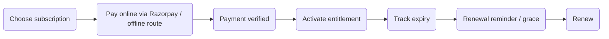

_Figure 2.13.3.1 – Payments, Subscription & Renewal high-level flow_

### 2.13.5 Functional Flow

#### 2.13.5.1 Online payment

1. User selects the applicable annual subscription.

2. App starts Razorpay checkout in the supported currency.

3. Payment result is confirmed through the approved integration.

4. Subscription entitlement is activated only after valid confirmation.

#### 2.13.5.2 Offline payment

1. User follows the approved offline payment process.

2. SRM verifies the payment outside the gateway.

3. Admin records/approves the payment in the Admin Portal.

4. Subscription status becomes active in the application.

### 2.13.8 User Permissions

#### 2.13.8.1 Role Definitions

Registered User, Premium Subscriber, SwaRaj Kriya User; Admin for payment management.

#### 2.13.8.2 Allowed Operations

- Eligible users may initiate online payment and view their own subscription status/history.

- Admin may record verified offline payments and manage allowed subscription status.

#### 2.13.8.3 Restricted Operations

- User cannot self-activate subscription without a valid confirmed payment/approved Admin action.

- No EMI option should come

### 2.13.10 User Stories

#### 2.13.10.1 Pay online for subscription

| **Story ID** | US-PAY-01 |
|---|---|
| **Primary Actor(s)** | Registered User |
| **User Story** | As a user, I want to pay through Razorpay so that my paid access is activated securely. |
| **Acceptance Criteria** | • Checkout opens with approved plan/currency. • Successful confirmed payment activates entitlement. • Failed/cancelled payment does not activate entitlement. |
| **Exception Scenarios** | • Gateway unavailable -> user can retry later or use the approved offline route. |
| **Dependencies** | • Razorpay account/entity and currency configuration. |

#### 2.13.10.2 Reflect an offline payment

| **Story ID** | US-PAY-02 |
|---|---|
| **Primary Actor(s)** | Admin / User |
| **User Story** | As an Admin, I want to record a verified offline payment so that the user’s subscription status is correctly reflected in the application. |
| **Acceptance Criteria** | • Admin records approved payment details. • Subscription entitlement updates after save/approval. • User sees updated status. |
| **Exception Scenarios** | • Incomplete/unverified payment -> entitlement is not activated. |
| **Dependencies** | • Final offline payment fields and approval process. |

### 2.13.12 Validation Rules

#### 2.13.12.2 Business Rules

- Subscription activation requires confirmed Razorpay result or authorized Admin offline-payment update.

- The USD price is calculated from the INR price at the current INR to USD conversion rate. No tax is calculated by the system.

- Renewal/grace dates must derive from the confirmed annual subscription policy.

### 2.13.13 Dependencies

- Razorpay account/entity.

- ~~Final INR/USD and international currency decision.~~

- ~~Final taxation/charges rules.~~

- Annual subscription price in INR, to be shared by SRM.

- Final grace period.

### 2.13.14 Acceptance Testing Scenarios

#### 2.13.14.1 Core Functionality Testing

| **Test ID** | **Scenario** | **Expected Result** |
|---|---|---|
| TC-PAY-001 | Complete successful Razorpay payment | Subscription activates. |
| TC-PAY-002 | Razorpay payment fails/cancels | Subscription does not activate. |
| TC-PAY-003 | Admin records verified offline payment | Subscription state updates in app. |
| TC-PAY-004 | Subscription approaches expiry | Renewal status/reminder is generated according to approved notification rule. |
| TC-PAY-005 | Renew annual subscription | New validity period is reflected correctly. |

#### 2.13.14.4 Edge Cases

| **Test ID** | **Scenario** | **Expected Result** |
|---|---|---|
| TC-PAY-006 | International user/payment currency not supported | User receives clear guidance; transaction is not silently converted with an unapproved rule. |
| TC-PAY-007 | Renew annual subscription | If renewed during the grace period, the new validity will start from the original expiry date, not the renewal date. The same validity dates will be reflected in the invoice, payment confirmation, and renewal notifications. |

### 2.13.15 Assumptions

- Annual subscription remains the current business direction.

### 2.13.16 Constraints

- Razorpay entity, subscription price and grace period are Pending SRM Confirmation.

## 2.14 Notifications

### 2.14.1 Module Overview

#### 2.14.1.1 Purpose

To define the notification events proposed for the application and provide a controlled notification master for SRM review before activation.

#### 2.14.1.2 Scope

In scope as a specification/validation module: proposed push/communication triggers and default-copy governance. Final Phase 1 inclusion and exact delivery channels require SRM confirmation.

#### 2.14.1.3 Target Users

Premium user and SK users as recipients.

#### 2.14.1.4 High-Level Functionality

FSD to document events that trigger notifications. The currently proposed scenarios are a daily SK reminder and new-content notification.

#### 2.14.1.5 Application Channel

| **Channel** | **Applicable?** | **Notes** |
|---|---|---|
| Web | No | The currently proposed scenarios are a daily SK reminder and new-content and event(future scope) notification |
| Mobile (iOS/Android) | Yes | Push/local notification receipt if approved. |

### 2.14.2 Key Characteristics

#### 2.14.2.1 Functional Capabilities

- Proposed: daily reminder to SK users to complete the day’s SwaRaj Kriya.

- Notify users when new content (blog, audio or video) is published. Opening the notification takes the user to that content in the app.” Add: “Notify SwaRaj Kriya users when a monthly, quarterly or yearly report is available. Opening the notification takes the user to the SK report section

- Notify a user when Admin adds a certificate for them. Opening the notification takes the user to the Certificates section.

#### 2.14.2.3 Operational Rules

- Opening a notification takes the user to the related screen in the app: the content item (blog, audio or video), the SK report section or the Certificates section.

### 2.14.3 Flow Diagrams

#### 2.14.3.1 Notifications Flow

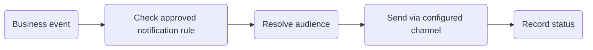

_Figure 2.14.3.1 – Notifications high-level flow_

### 2.14.5 Functional Flow

#### 2.14.5.1 Trigger notification

1. A configured business event occurs.

2. System checks the approved notification master.

| **ID** | **Notification** | **Recipient** | **Trigger and proposed timing** | **Channel** | **Suggested message** | **Destination** |
|---|---|---|---|---|---|---|
| N01 | Daily Swaraj Kriya reminder | Active SK users with valid practice access | Daily at the approved reminder time; proposed default 7:00 AM in the user’s reporting timezone. Suppress when a qualifying practice is already recorded for that day. | Push; in-app presentation proposed | Your practice reminder — Take some time for your Swaraj Kriya practice today. | SK Home/readiness screen |
| N02 | New content published | Users entitled to the published content | After an authorized Admin publishes an item and enables its notification. Publication edits must not automatically resend it. | Push/in-app proposed | New content available — Explore “{content_title}” in {content_language}. | The published content item (blog, audio or video) in the app |
| N03A | SK access activated | User whose SK access becomes active | Once the required course, payment, approval and programme/Leader/group conditions are satisfied. Application submission alone must not trigger it. | In-app; WhatsApp activation communication, subject to delivery-method confirmation | Your Swaraj Kriya access is active — You can now access your practice and assigned programme in the app. | SK Home |
| N03B | Leader or group assignment updated | Affected SK member | After an authorized assignment or reassignment is saved. Combine with activation communication when both happen together. | In-app; push proposed | Your Kriya group details have been updated — Open the app to view your assigned Leader and group. | My Leader/group details |
| N04A | Monthly practice report available | User by default; Leader/ Admin recipients require approval | After the previous reporting month closes(1 month = 1st sunday of the month till last saturday of the month). Proposed schedule: 4th of every month at 9:00 AM, using the approved reporting timezone. | WhatsApp, as requested | Your monthly practice report is ready — View your Swaraj Kriya summary for {month_year}: {secure_report_link}. | SK report section (monthly) |
| N04B | Yearly practice report available | User by default; Leader/ Admin recipients require approval | After the approved reporting year closes. (1 year = 1st sunday of the year till last saturday of the year)Proposed schedule: 15th January at 9:00 AM, if calendar-year reporting is approved. | WhatsApp, as requested | Your yearly practice report is ready — View your Swaraj Kriya summary for {year}: {secure_report_link}. | SK report section (yearly) |
| N04C | Quarterly practice report available | User by default; Leader/ Admin recipients require approval | After each configured reporting period closes. After each configured quarter ends  and can be changed for the next year. For example, three reports in a year with periods of 3, 4 and 5 months. A period runs from the 1st Sunday of the period to the last Saturday of the period. The report is sent on the 15th of the month after the period ends. | WhatsApp, as requested | Your quarterly practice report is ready — View your Swaraj Kriya summary for {report_period}: {secure_report_link}. | SK report section (quarterly) |
| N05 | Leader’s assigned group updated | Relevant Kriya Leader | When Admin assigns a group or changes its membership. Notify only the affected Leader; final event list requires approval. | In-app with deep link, as requested ; push optional | Your assigned group has been updated — Open the app to review the latest group details. | Leader’s assigned-group screen |
| N06 | Subscription renewal reminder | SK or non-SK subscriber whose paid access is approaching expiry | Conditional proposal: 7 days and 1 day before expiry. Cancel pending reminders after successful renewal. | Push/in-app proposed | Your subscription expires soon — Your {subscription_name} expires on {expiry_date}. View your renewal options. | Subscription/renewal screen |
| N07 | Certificate added | The user the certificate is added for | After Admin adds the certificate for the user | Push/in-app proposed | Your certificate is ready — View your {certificate_name} in the Certificates section. | Certificates section |

3. Applicable audience and timing are resolved.

4. Notification is sent through the configured channel and status is recorded where available.

### 2.14.8 User Permissions

#### 2.14.8.1 Role Definitions

SK and non SK users as recipients

#### 2.14.8.2 Allowed Operations

- Recipients may receive notifications according to the mentioned scenarios.

#### 2.14.8.3 Restricted Operations

- Unapproved notification events/copy must not be introduced into the scope.

### 2.14.10 User Stories

#### 2.14.10.1 Receive daily Kriya reminder

| **Story ID** | US-NOTI-01 |
|---|---|
| **Primary Actor(s)** | SwaRaj Kriya User |
| **User Story** | As an SK user, I want a daily reminder so that I remember to complete the day’s practice. |
| **Acceptance Criteria** | • Reminder is sent according to approved timing. • Only applicable SK users are targeted. |
| **Exception Scenarios** | • Notification provider unavailable -> practice remains usable and failure is logged. |
| **Dependencies** | • SRM-approved notification master. |

#### 2.14.10.2 Receive renewal reminder

| **Story ID** | US-NOTI-02 |
|---|---|
| **Primary Actor(s)** | Premium / SK Subscriber |
| **User Story** | As a subscriber, I want a notification when Admin publishes relevant new content |
| **Acceptance Criteria** | • Reminder is sent according to approved timing. • Only applicable SK users are targeted. |
| **Exception Scenarios** | • Notification provider unavailable -> practice remains usable and failure is logged. |
| **Dependencies** | • SRM-approved notification master. |

### 2.14.12 Validation Rules

#### 2.14.12.2 Business Rules

- Notification must have an approved trigger and audience.

- Audience filters must not expose one user’s data to another.

### 2.14.13 Dependencies

- Notification provider.

- Final Phase 1 inclusion.

- SRM-approved notification master.

### 2.14.14 Acceptance Testing Scenarios

#### 2.14.14.1 Core Functionality Testing

| **Test ID** | **Scenario** | **Expected Result** |
|---|---|---|
| TC-NOTI-001 | Daily reminder time occurs for active SK user | Approved reminder is generated. |
| TC-NOTI-002 | Admin publishes a new blog, audio or video | The notification opens that content in the app. |
| TC-NOTI-003 | A monthly, quarterly or yearly SK report is available | The notification is sent, and the user goes to the SK report section . |
| TC-NOTI-004 | Admin adds certificates for a particular user or  several users | Each user receives a notification for their own certificate only. |

#### 2.14.14.4 Edge Cases

| **Test ID** | **Scenario** | **Expected Result** |
|---|---|---|
| TC-NOTI-001 | Duplicate event received | User does not receive unintended duplicate notifications according to implementation safeguards. |
| TC-NOTI-002 | The same certificate event is received twice | The user receives one notification. |

### 2.14.15 Assumptions

- Not Applicable

### 2.14.16 Constraints

- Final notification channels, exact timing/copy and Phase 1 inclusion remain Pending SRM Confirmation.

## 2.15 Language & Localization

### 2.15.1 Module Overview

#### 2.15.1.1 Purpose

To provide an accessible multilingual application interface while keeping translation scope aligned with SRM’s confirmed content strategy.

#### 2.15.1.2 Scope

In scope: English/Hindi application menus, headings, labels and static interface text. These menu items and headings can be managed and updated in both languages through the Admin Portal using the multilingual options.

#### 2.15.1.3 Target Users

All mobile-app users.

#### 2.15.1.4 High-Level Functionality

The application will support localized UI text. English remains the base language and Hindi menus/headings/static text are part of the working requirement. Translation of full content is not considered.

#### 2.15.1.5 Application Channel

| **Channel** | **Applicable?** | **Notes** |
|---|---|---|
| Web | No | English remains the base language and Hindi menus/headings/static text are part of the working requirement. Translation of full content is not considered |
| Mobile (iOS/Android) | Yes | Localized menu/headings/static UI. |

### 2.15.2 Key Characteristics

#### 2.15.2.1 Functional Capabilities

- Present application menus/headings/static labels in English.

- Present corresponding approved Hindi translations.

- Allow the user to select a supported interface language.

- Persist selected language preference.

#### 2.15.2.3 Operational Rules

- No automatic machine translation is assumed.

- SRM must provide/approve final Hindi copy and terminology.

### 2.15.3 Flow Diagrams

#### 2.15.3.1 Language & Localization Flow

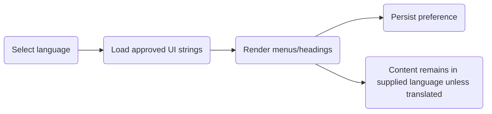

_Figure 2.15.3.1 – Language & Localization high-level flow_

### 2.15.5 Functional Flow

#### 2.15.5.1 Change interface language

1. User opens language preference.

2. User selects English or Hindi.

3. App reloads available approved interface strings.

4. Preference is persisted.

### 2.15.8 User Permissions

#### 2.15.8.1 Role Definitions

All mobile-app users.

#### 2.15.8.2 Allowed Operations

- User may select supported interface language.

#### 2.15.8.3 Restricted Operations

- App does not generate unapproved translations of content or auto context translations.

### 2.15.10 User Stories

#### 2.15.10.1 Use Hindi interface

| **Story ID** | US-LANG-01 |
|---|---|
| **Primary Actor(s)** | Mobile User |
| **User Story** | As a user, I want menus and headings in Hindi so that I can navigate the application more comfortably. |
| **Acceptance Criteria** | • Approved Hindi strings are shown for supported UI. |
| **Exception Scenarios** | • Translation missing -> approved fallback language is shown and missing key is logged. |
| **Dependencies** | • SRM-approved Hindi strings. |

### 2.15.12 Validation Rules

#### 2.15.12.2 Business Rules

- Language value must be one of the configured supported UI languages (App interface based text only)

- Missing translation keys must fall back predictably.

### 2.15.13 Dependencies

- SRM Hindi copy/terminology approval.

### 2.15.14 Acceptance Testing Scenarios

#### 2.15.14.1 Core Functionality Testing

| **Test ID** | **Scenario** | **Expected Result** |
|---|---|---|
| TC-LANG-001 | Select Hindi | Supported UI strings display in Hindi. |
| TC-LANG-002 | Relaunch app | Selected language persists. |
| TC-LANG-003 | Open content supplied only in English | Content remains in supplied language unless a translated asset exists. |
| TC-LANG-004 | Switch back to English | Supported UI strings return to English. |
| TC-LANG-005 | Missing Hindi key | Fallback works without broken layout. |

#### 2.15.14.4 Edge Cases

| **Test ID** | **Scenario** | **Expected Result** |
|---|---|---|
| TC-LANG-006 | Long Hindi label on small device | UI remains readable without clipping under supported design. |
| TC-LANG-007 | Content tagged with another language | Interface localization does not alter the original content asset. |

### 2.15.15 Assumptions

- English and Hindi remain the working UI languages.

### 2.15.16 Constraints

- Not Applicable

## 2.16 Kriya Leader, Group & WhatsApp Communication

### 2.16.1 Module Overview

#### 2.16.1.1 Purpose

To support the operational relationship between Kriya Leaders and assigned SwaRaj Kriya participant groups and enable approved WhatsApp-based communication outside the application.

#### 2.16.1.2 Scope

In scope: Admin designation of Kriya Leaders, group creation, participant-to-group/Leader mapping, reassignment and external WhatsApp communication entry points/approval message. Leader content authoring from the old Guru model is not treated as confirmed scope.

#### 2.16.1.3 Target Users

Admin; Kriya Leader; SwaRaj Kriya User as assigned participant.

#### 2.16.1.4 High-Level Functionality

Admin creates/manages Kriya Leaders and groups and assigns SK participants to the appropriate Leader/group. Leaders communicate with their group members through WhatsApp outside the application. A user approved as SK may receive an approval message through the configured WhatsApp approach.

#### 2.16.1.5 Application Channel

| **Channel** | **Applicable?** | **Notes** |
|---|---|---|
| Web | Yes | Admin Leader/group management. |
| Mobile (iOS/Android) | Yes | Participant may see assigned Leader; Leader/participant may launch approved WhatsApp communication if included. |

### 2.16.2 Key Characteristics

#### 2.16.2.1 Functional Capabilities

- Admin may designate an eligible user as Kriya Leader.

- Admin may create groups and assign a Kriya Leader to each group.

- Admin may add/remove/reassign SK participants within groups.

- Participant may see assigned Leader information where approved in UI.

- Leader may communicate with assigned group members through WhatsApp outside the application.

- Approval communication through WhatsApp may be triggered when Admin marks a user as SK.

- Maintain a history table for programme changes and Kriya Leader/group changes. Each entry records the practitioner, the previous and new value, the date, the Admin user who made the change and the reason. Programme entries also record the effective date.

#### 2.16.2.3 Operational Rules

- WhatsApp is used in two ways. (1) Leader-to-participant communication: the Kriya Leader selects Message on WhatsApp for an assigned participant, which opens the participant's chat in the WhatsApp application on the device, outside the SRM app. (2) System messages, such as the approval/welcome message and programme change messages: these are sent through the WhatsApp Business API using SRM-approved message templates. No in-app chat is provided.

- No in-app peer/community chat is assumed.

- Leader content/course/event authoring capabilities from earlier proposal language are not carried forward as confirmed requirements.

- When a user's Kriya Leader designation is deactivated, the user continues as a SwaRaj Kriya practitioner but no longer has Leader access. The Leader view and any history as a Kriya Leader are no longer available to that user.

- Cardinality rules such as one Leader to multiple groups or multiple Leaders per group require final confirmation.

### 2.16.3 Flow Diagrams

#### 2.16.3.1 Kriya Leader, Group & WhatsApp Communication Flow

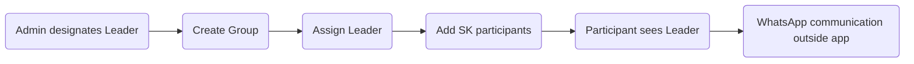

_Figure 2.16.3.1 – Kriya Leader, Group & WhatsApp Communication high-level flow_

### 2.16.5 Functional Flow

#### 2.16.5.1 Create and assign group

1. Admin creates/selects a Kriya Leader.

2. Admin creates a participant group.

3. Admin assigns the Leader to the group.

4. Admin adds applicable SK users.

5. Mappings become visible to the relevant experiences.

#### 2.16.5.2 Communicate via WhatsApp

1. Leader selects the approved communication entry point for an assigned participant/group.

2. The application opens or triggers the approved WhatsApp route outside the app.

3. Conversation occurs in WhatsApp, not inside SRM app.

### 2.16.8 User Permissions

#### 2.16.8.1 Role Definitions

Admin; Kriya Leader; SwaRaj Kriya User as assigned participant.

#### 2.16.8.2 Allowed Operations

- Admin may manage Leader/group mapping.

- Leader may use approved WhatsApp communication route for assigned group members.

- Participant may view assigned Leader where configured.

#### 2.16.8.3 Restricted Operations

- Leader cannot access unrelated groups/users.

- No unapproved in-app chat or content-authoring privilege is assumed.

### 2.16.10 User Stories

#### 2.16.10.1 Assign participants to a Kriya Leader

| **Story ID** | US-LEAD-01 |
|---|---|
| **Primary Actor(s)** | Admin |
| **User Story** | As an Admin, I want to create groups and assign participants to the appropriate Kriya Leader so that the operational guidance structure is reflected in the system. |
| **Acceptance Criteria** | • Group can be created. • Active Leader can be assigned. • SK participants can be added/reassigned. |
| **Exception Scenarios** | • Inactive Leader -> assignment is refused. |
| **Dependencies** | • Final group cardinality rules. |

#### 2.16.10.2 Contact assigned participant through WhatsApp

| **Story ID** | US-LEAD-02 |
|---|---|
| **Primary Actor(s)** | Kriya Leader |
| **User Story** | As a Kriya Leader, I want to communicate with my assigned group members through WhatsApp so that follow-up occurs using the agreed external channel. |
| **Acceptance Criteria** | • Only assigned members are available through the approved route. • Communication opens outside the SRM app. |
| **Exception Scenarios** | • WhatsApp unavailable -> app does not create an in-app chat fallback unless separately approved. |
| **Dependencies** | • Final WhatsApp integration method. |

### 2.16.12 Validation Rules

#### 2.16.12.2 Business Rules

- Leader must be active before group assignment.

- Participant must hold the applicable SK status before being mapped to an SK group, unless SRM approves another rule.

- Leader access to participant data must be limited to assigned group scope.

### 2.16.13 Dependencies

- Final group cardinality/reassignment rules.

- WhatsApp integration method and approved messaging account if automation is required.

### 2.16.14 Acceptance Testing Scenarios

#### 2.16.14.1 Core Functionality Testing

| **Test ID** | **Scenario** | **Expected Result** |
|---|---|---|
| TC-LEAD-001 | Admin creates group and assigns active Leader | Mapping saves successfully. |
| TC-LEAD-002 | Admin adds SK participants to group | Participants are correctly mapped. |
| TC-LEAD-003 | Participant views assigned Leader | Correct Leader is shown. |
| TC-LEAD-004 | Leader opens WhatsApp communication for assigned member | Approved external WhatsApp route opens. |
| TC-LEAD-005 | Admin reassigns participant | New mapping is reflected according to approved rule. |

#### 2.16.14.4 Edge Cases

| **Test ID** | **Scenario** | **Expected Result** |
|---|---|---|
| TC-LEAD-006 | Leader is deactivated | Affected groups are flagged/reassignment is required. |
| TC-LEAD-007 | Leader attempts access to unassigned participant | Access is denied. |

### 2.16.15 Assumptions

- Admin is the governing role for Leader/group mapping.

### 2.16.16 Constraints

- Exact group cardinality and WhatsApp integration approach remain Pending SRM Confirmation.

## 2.17 Help, Quarterly Feedback, Policies & Consent

### 2.17.1 Module Overview

#### 2.17.1.1 Purpose

To provide user support, collect periodic application feedback and implement required Privacy Policy, Terms & Conditions and consent experiences.

#### 2.17.1.2 Scope

In scope: FAQs/help contact, quarterly feedback prompt/collection, policy pages, registration consent and legal-content display. Final legal wording is supplied/reviewed with SRM.

#### 2.17.1.3 Target Users

All mobile users; Admin for managed support/policy content where applicable.

#### 2.17.1.4 High-Level Functionality

Users can access help and policy information and provide general application feedback. A quarterly feedback mechanism is required in addition to post-Kriya feedback. Terms & Conditions acceptance is mandatory during registration. SRM will supply or review legal content, with INT preparing/implementing the application pages and consent flow.

#### 2.17.1.5 Application Channel

| **Channel** | **Applicable?** | **Notes** |
|---|---|---|
| Web | Yes | Admin may manage/publish approved help/policy content. |
| Mobile (iOS/Android) | Yes | Help, quarterly feedback, Privacy Policy, T&C and consent display. |

### 2.17.2 Key Characteristics

#### 2.17.2.1 Functional Capabilities

- View Privacy Policy and Terms & Conditions.

- Capture mandatory T&C acceptance during registration.

- Provide Help/FAQ/support information.

- Collect quarterly user feedback through the agreed form/trigger.

| **Question** | **Answer type** | **Required/Mandatory** |
|---|---|---|
| How satisfied are you with the SRM app overall? | Rating, 1 to 5 stars | Yes |
| How easy is the app to use? | Rating, 1 to 5 stars | Yes |
| Which part of the app do you use most? | Single choice: SwaRaj Kriya practice, Practice audio, Bhakti, Videos & Talks, Blogs | No |
| Did you face any problem in the last 3 months? | Multiple choice: Login or OTP, Audio download or playback, Syncing of my practice, Payment or renewal, Notifications, Other, No problem | No |
| What can we improve? | Free text, up to 500 characters | No |
| May the SRM team contact you about your feedback? | Yes / No | No |

- Allow Admin to publish/update approved policy/help content.

- Capture consent/version reference where required by the approved compliance design.

#### 2.17.2.3 Operational Rules

- Legal content must be supplied or reviewed/finalized with SRM before production use.

- DPDP compliance checklist is expected from SRM for implementation/validation.

- Quarterly feedback is separate from post-Kriya feedback.

- Exact quarterly feedback questions and trigger date are Pending SRM Confirmation.

### 2.17.3 Flow Diagrams

#### 2.17.3.1 Help, Quarterly Feedback, Policies & Consent Flow

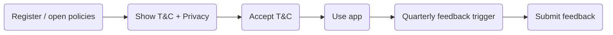

_Figure 2.17.3.1 – Help, Quarterly Feedback, Policies & Consent high-level flow_

### 2.17.5 Functional Flow

#### 2.17.5.1 Consent during registration

1. User registers.

2. App presents required Terms & Conditions/Privacy references.

3. User accepts required terms.

4. System records the accepted version/date as defined by compliance design.

#### 2.17.5.2 Quarterly feedback

1. Quarterly feedback trigger occurs according to approved schedule.

2. User opens the feedback form.

3. User submits or dismisses according to the final rule.

### 2.17.8 User Permissions

#### 2.17.8.1 Role Definitions

All mobile users; Admin for managed support/policy content where applicable.

#### 2.17.8.2 Allowed Operations

- User may read policies/help and submit applicable feedback.

- Admin may manage approved content if enabled.

#### 2.17.8.3 Restricted Operations

- App must not present unapproved legal text as final.

### 2.17.10 User Stories

#### 2.17.10.1 Accept Terms & Conditions

| **Story ID** | US-POL-01 |
|---|---|
| **Primary Actor(s)** | New User |
| **User Story** | As a new user, I want the applicable Terms & Conditions and Privacy Policy to be accepted by default during registration, with links to read them, so that registration is completed with the consent is recorded. |
| **Acceptance Criteria** | • Policy links are accessible. • Required acceptance is captured before registration completes. |
| **Exception Scenarios** | • Policy content unavailable -> registration cannot complete if consent is mandatory. |
| **Dependencies** | • Final SRM-reviewed legal content. |

#### 2.17.10.2 Provide quarterly feedback

| **Story ID** | US-POL-02 |
|---|---|
| **Primary Actor(s)** | Registered User |
| **User Story** | As a user, I want to periodically share feedback about the application so that SRM can understand my experience. |
| **Acceptance Criteria** | • Quarterly feedback form appears according to approved trigger. • Submission is stored for reporting. |
| **Exception Scenarios** | • Feedback service unavailable -> app remains usable; user may retry later if applicable. |
| **Dependencies** | • Final questionnaire and timing. |

### 2.17.12 Validation Rules

#### 2.17.12.2 Business Rules

- Mandatory consent must be captured before registration completion.

- Quarterly feedback submission must be associated with the correct user where the form is not anonymous.

### 2.17.13 Dependencies

- SRM Privacy Policy/T&C content and DPDP checklist.

- Final quarterly feedback questionnaire and schedule.

### 2.17.14 Acceptance Testing Scenarios

#### 2.17.14.1 Core Functionality Testing

| **Test ID** | **Scenario** | **Expected Result** |
|---|---|---|
| TC-POL-001 | Register without accepting mandatory T&C | Registration does not complete. |
| TC-POL-002 | Accept current T&C and register | Consent is recorded and registration proceeds. |
| TC-POL-003 | Open Privacy Policy | Approved current policy is displayed. |
| TC-POL-004 | Quarterly feedback trigger occurs | Feedback prompt/form is available according to final rule. |
| TC-POL-005 | Submit quarterly feedback | Submission is recorded successfully. |

#### 2.17.14.4 Edge Cases

| **Test ID** | **Scenario** | **Expected Result** |
|---|---|---|
| TC-POL-006 | Policy version changes | Re-consent behaviour follows final compliance rule. |
| TC-POL-007 | User is offline when quarterly feedback is due | App handles prompt/submission according to final online/offline rule without blocking core usage. |

### 2.17.15 Assumptions

- SRM will supply/review and finalize legal content before release.

### 2.17.16 Constraints

- Exact consent retention/re-consent rules and quarterly feedback fields remain to be finalized.

## 2.18 Admin Portal

### 2.18.1 Module Overview

#### 2.18.1.1 Purpose

To provide the web-based operational control plane for users, SwaRaj Kriya access, Leaders/groups, content, payments, counts, reporting, notifications and configuration.

#### 2.18.1.2 Scope

In scope, dashboard, user management, SK approval, Leader/group mapping, content/media management, count adjustment, payments/subscriptions, reporting, access configuration, policy/help content, notification master where included, sending custom push notifications, audit/logging and manual migration support. Editing of notification content, editing of Terms & Conditions, Privacy Policy and other help/policy pages, and management of blogs, events and other content (upload, edit, publish, unpublish).Manage the programme master (create, edit, activate, deactivate) with assign and change a practitioner’s programme along with monitor practitioner adherence against programme targets. The Admin Portal modules are listed in 2.18.1.6.

Access is controlled through role-based access control (RBAC) with PII masking. The Admin Portal roles are:

- **Super Admin:** full access to all modules and features.

- **Content Admin:** Bhakti, Practice, and Videos & Talks content.

- **Blog Admin:** blog management.

- **Event Admin:** event management.

- **Swaraj Kriya Admin:** SwaRaj Kriya-related features.

- **Finance Admin:** payment and finance-related features.

Sub-admins (Content Admin and Blog Admin) send a request to the Admin user (excluding Sri Guru's email ID) to publish content, and are notified when it is published. Both notifications are sent by email.

#### 2.18.1.3 Target Users

Super Admin, Content Admin, Blog Admin, Event Admin, Swaraj Kriya Admin and Finance Admin, each with access as defined in 2.18.8.

#### 2.18.1.4 High-Level Functionality

The Admin Portal is the central operational interface for Phase 1. It manages user lifecycle and entitlements, publishes/updates content, records offline payments, controls free/premium access, manages Leaders/groups, adjusts approved counts, provides reports and supports release operations.

#### 2.18.1.5 Application Channel

| **Channel** | **Applicable?** | **Notes** |
|---|---|---|
| Web | Yes | Primary/only Admin channel. |
| Mobile (iOS/Android) | No | Admin mobile access is not assumed for the Phase 1. |

#### 2.18.1.6 Admin Portal Modules

| **Module** | **Covers** | **Role** | **Flow** |
|---|---|---|---|
| Notification Content Management | Edit the title and message text of notifications in the notification master, with preview and version history | Super Admin | 2.18.5.3 |
| Terms & Conditions Management | Edit and publish the Terms & Conditions, with versions and an effective date | Super Admin | 2.18.5.4 |
| Content Pages Management | Edit Privacy Policy and other help/policy pages, blogs and events, and upload and manage Practice, Bhakti and Videos & Talks content | Super Admin (policy pages), Blog Admin (blogs), Event Admin (events), Content Admin (content) | 2.18.5.5 |
| Kriya Leader Management Centre | Participant list, progress view and report downloads for the Kriya Leader’s group | Kriya Leader | 2.18.2.4 |
| Quarter Configuration | Set and change the start and end dates of each quarter. | Super Admin | 2.18.2.5 |
| Age Group Management | Create age groups and assign seekers to them | Super Admin | 2.18.2.6 |
| Reason Master | Manage the reasons offered for SwaRaj Kriya completion feedback | SK Admin | 2.18.2.7 |

### 2.18.2 Key Characteristics

#### 2.18.2.1 Functional Capabilities

- View dashboard with key user, SK, payment, content and activity summaries.

- Manage users, access status and applicable profile/entitlement information.

- Approve/mark SwaRaj Kriya users and assign Leader/group.

- Designate Kriya Leaders and manage groups/membership.

- Publish/manage current Kriya audio and applicable Practice/Explore content.

- Configure content access as public/free/premium/SK-specific.

- View and perform authorized manual Kriya-count adjustments; backend changes synchronize to app.

- Manage Razorpay transaction visibility and record verified offline payments.

- View monthly/yearly and other approved reports.

- Manage approved policies/help/notification master where applicable.

- Maintain role-based access control, activity logs and audit-relevant administrative actions.

- Support manual migration/export/import activities required for initial website/app coordination.

- Edit the message content of notifications in the notification master (title and text), with preview and version history.

- Edit and publish Terms & Conditions, Privacy Policy, FAQs and other help/policy pages, with versions and effective dates.

- Create, edit, publish and unpublish blogs, and upload and manage Practice, Bhakti and Videos & Talks content, through the approval workflow.

- Create and manage events

- Manage the programme master (create, edit, activate, deactivate). Admin can manage the reason master for SwaRaj Kriya completion feedback from the Admin Portal.

- Assign and change a practitioner’s programme.

- Monitor practitioner adherence against programme targets.

- Configure and modify the start and end dates of each quarter (Q1, Q2, Q3 and Q4).

- Create age groups and assign seekers to their age group.

#### 2.18.2.3 Operational Rules

- Admin access must use authentication, authorization, bearer-token protection and RBAC; HTTPS/TLS alone is not sufficient.

- Events and ~~course management~~ are excluded from the Phase 1 Admin scope.

- Count adjustments, entitlement changes and offline payment updates should be auditable administrative actions.

- Exact Admin sub-role/permission matrix requires SRM confirmation if multiple Admin role variants are needed.

#### 2.18.2.4 Kriya Leader Management Centre

The Leader sees only the participants mapped to them. The leader can progress the assessment, Check seekers list and Download report.

##### 2.18.2.4.1 Progress Assessment

In the selected year and term, the SK leaders can  select the seekers to whom the assessment is to be assigned, and define the Nivrutti Hours and associated practices.

- **Year and Term Selection:** The system shall allow the SK Leader to select the applicable year and the corresponding term, i.e., First Term or Second Term. Based on the selected year and term, the system shall dynamically populate the relevant list of questionnaires for the seeker assessment.

- **Questionnaire Population:** The system shall display the questionnaire(s) applicable to the selected year, term and age group, enabling the SK Leader to review the available assessment content before proceeding with seeker selection.

- **Seeker Selection:** The system shall allow the SK Leader to select the seekers to whom the assessment is to be assigned. The assessment shall be associated with the selected seekers based on the configured year, term, and corresponding questionnaire.

- **Nivrutti Hours (Weekly):** The system shall provide an input field for the SK Leader to specify the weekly Nivrutti Hours applicable to the selected assessment configuration.

- **Practices for Nivrutti Hours:** The system shall provide a set of checkbox options, allowing the SK Leader to select one or more practices applicable to Nivrutti Hours. The available options shall include:

   - Swaraj Kriya

   - SRM Seva

   - Listening to Satsangs and Bhakti

   - Dear Seeker Exam

   - Me-Time (Sadguru Sutra / What Next)

- **Priority Handling:** The system shall provide a Yes/No option for the SK Leader to indicate whether priority handling is applicable to the assessment or its associated configuration.

- **Comments:** The system shall provide a comments field for the SK Leader to enter any relevant remarks or additional information associated with the assessment configuration.

**Expected Outcome:** The SK Leader shall be able to configure the seeker assessment by selecting the applicable year and term, reviewing the corresponding questionnaire, assigning the assessment to selected seekers, and specifying the weekly Nivrutti Hours, applicable practices, priority handling, and comments.

##### 2.18.2.4.2 Seekers Listing

The system shall provide the Swaraj Kriya (SK) Leader with a consolidated view of the seekers and SK practitioners mapped under their leadership. The feature shall enable the SK Leader to review individual practitioner details and monitor Swaraj Kriya activity counts and interruptions based on the assigned program type.

- **Seeker / SK Practitioner Listing:** The system shall display a list of seekers or SK practitioners associated with the respective SK Leader, along with the following details:

   - **Code:** The unique code assigned to the seeker or SK practitioner.

   - **Name:** The name of the seeker or SK practitioner.

   - **Program Type:** The program type assigned to the respective seeker or SK practitioner.

   - **Seeker ID:** The unique identifier associated with the seeker.

   - **Last Sync Timing:** The date and time of the most recent synchronization recorded for the respective seeker or SK practitioner.

   - **Age Group** - The age group to which the seeker belongs.

- **Swaraj Kriya Count Monitoring:** The system shall enable the SK Leader to review Swaraj Kriya activity counts for individual seekers or SK practitioners. The activity count shall be available across the following time-based views:

   - **Day-wise:** Swaraj Kriya count for individual days.

   - **Week-wise:** Swaraj Kriya count aggregated by week.

   - **Month-wise:** Swaraj Kriya count aggregated by month.

- **Program Interruption Monitoring:** The system shall provide details of interruptions recorded during the Swaraj Kriya practice associated with the assigned program type. This shall enable the SK Leader to review interruption information for the respective seeker or SK practitioner alongside their activity records.

**Expected Outcome:** The SK Leader shall be able to view the list of associated seekers and SK practitioners, review their identification and synchronization details, monitor daily, weekly, and monthly Swaraj Kriya counts, and examine recorded interruptions for their assigned program types.

##### 2.18.2.4.2 Download Report

**1. Single Seeker Year-to-Date (YTD) Report**

The system shall allow the SK Leader to generate a Year-to-Date (YTD) report for an individual seeker by selecting the applicable year and the seeker from the available list of seekers associated with the respective SK Leader.

- **Input Parameters:**

   - Year

   - Seeker

   - Age group

- **Output:** The system shall generate the report for the selected seeker and year in the prescribed format, as per the report template attached - <u>Single SeekerYTD Report</u>

**2. All Seekers Duration Report**

The system shall allow the SK Leader to generate a report covering multiple seekers for a specified duration. The SK Leader shall be able to define the reporting period by selecting a start date and an end date, along with the required seeker status.

- **Input Parameters:**

   - Start Date

   - End Date

   - Status: Active / Inactive

   - Age group

- **Output:** The system shall generate a report containing the relevant information for seekers matching the selected duration and status, in the prescribed format, as per the report template attached - <u>All Seekers Duration Report</u>

**3. Progress Assessment Report**

The system shall allow the SK Leader to generate a Progress Assessment Report based on the selected year, quarter, and seeker status.

- **Input Parameters:**

   - Year

   - Quarter

   - Status: Active / Inactive

   - Age group

- **Output:** The system shall generate a progress assessment report for the selected reporting period and status in the prescribed format, as per the report template attached - <u>Progress Assessment Report</u>

**4. General List of Seekers Report**

The system shall allow the SK Leader to generate and download a general listing of seekers associated with the respective SK Leader by selecting the required seeker status.

- **Input Parameters:**

   - Status: Active / Inactive

   - Age group

- **Output:** The system shall generate a list of seekers matching the selected status in the prescribed report format.

**Expected Outcome:**

The SK Leader shall be able to generate and download the required reports using the applicable selection criteria. Each report shall display the relevant information based on the selected parameters and follow its designated output format. The detailed report layouts and field structures shall be aligned with the respective report templates attached - <u>General List of Seekers</u>

#### 2.18.2.5 Quarter Configuration

The system shall allow the Admin to dynamically configure and modify the start and end dates of each quarter (Q1, Q2, Q3 and Q4). The configured quarters are used wherever a quarter is shown or reported.

#### 2.18.2.6 Age Group Management

- Age groups are used for reporting and analytics.

- The Super Admin assigns each seeker to an age group by hand. The age group is shown on the seeker’s record in the Admin Portal.

- **Reports:** age group is available as a filter in the Admin reports.

- **Access:** only the Super Admin can create age groups and assign seekers to them. Group creation and assignment are recorded in the audit log.

#### 2.18.2.7 Reason Master

Admin can manage the reason master (for SwaRaj Kriya completion feedback) from the Admin Portal.

### 2.18.3 Flow Diagrams

#### 2.18.3.1 Admin Portal Flow

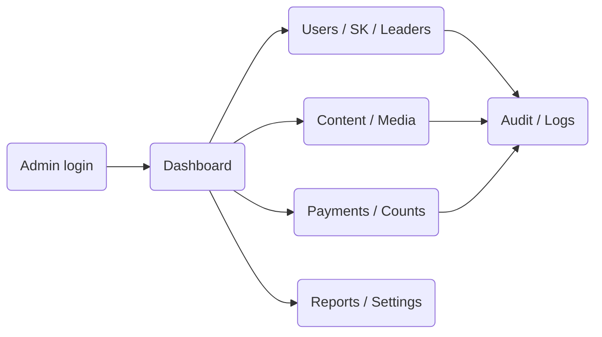

_Figure 2.18.3.1 – Admin Portal high-level flow_

### 2.18.5 Functional Flow

#### 2.18.5.1 Approve and map SK user

1. Admin opens the user/SK queue.

2. Admin verifies the user’s completed offline status.

3. Admin marks SK entitlement.

4. Admin assigns Leader and group.

5. The system updates the user and triggers configured approval communication.

#### 2.18.5.2 Record offline payment

- The user selects the Offline Payment option, and the application connects the user with the SRM team.

- The SRM team handles and completes the offline payment process with the user.

- After the offline payment is received, the Admin opens payment management in the Admin panel and manually updates the payment status.

- The system updates the user's subscription state and records the administrative action.

#### 2.18.5.3 Edit notification content

1. Super Admin opens the notification master and selects a notification.

2. Super Admin edits the title and message text. Placeholders (for example, the content title) can be moved but not removed or altered.

3. Super Admin previews the message and saves it.

4. The system saves a new version, records the previous and new text in the audit log, and applies the new text to notifications sent from then on. Notifications already sent are unchanged.

5. A WhatsApp message is used only after its new text has been approved as a WhatsApp template. Until then the last approved text is used.

#### 2.18.5.4 Edit Terms & Conditions, Privacy Policy and other pages

1. Super Admin opens the policy/help page and edits the content in the rich text editor.

2. Super Admin saves as draft, previews, and publishes with an effective date.

3. The system saves a new version and keeps the previous versions. The app shows the current published version.

4. Consent records show the version the user accepted.

#### 2.18.5.5 Manage blogs and other content

1. Content Admin or Blog Admin creates or edits an item, sets its Free or Premium access, and submits it for approval.

2. Super Admin approves or rejects it. The requester is notified by email, as agreed.

3. An approved item is published. An edit to a published item stays as a pending version until approved.

4. An item can be unpublished with a reason.

### 2.18.8 User Permissions

#### 2.18.8.1 Role Definitions

Admin Portal access is controlled through role-based access control (RBAC) with PII masking. The roles are Super Admin, Content Admin, Blog Admin, Event Admin, Swaraj Kriya Admin and Finance Admin. Each role sees and acts only on the modules and data permitted to it. Masked values show partial characters (for example, 98XXXXXX21). Exports and reports apply the exporting role's masking. Application logs never contain OTPs, payment data or unmasked PII.

#### 2.18.8.2 Allowed Operations

| **Role** | **Allowed** |
|---|---|
| Super Admin | All modules. Edits notification content, Terms & Conditions, Privacy Policy and help pages. Approves content, Programme master and assignment , Configures quarter start and end dates, Creates age groups and assigns seekers to them. |
| Content Admin | Uploads, edits and submits Bhakti, Practice and Videos & Talks content. |
| Blog Admin | Creates, edits and submits blogs. |
| Event Admin | Creates and edits events (Clarification Required). |
| Swaraj Kriya Admin | SwaRaj Kriya features, including SwaRaj Kriya tracks, Programme master and assignment. Add of the reason master to the role that manages it |
| Finance Admin | Payments and finance. |
| Kriya Leader | Own group’s participants only: Progress assessment, seeking list, download reports. |

#### 2.18.8.3 Restricted Operations

- Admin functions cannot be accessed without valid role authorization.

- No Admin action may bypass configured validation/audit requirements.

### 2.18.10 User Stories

#### 2.18.10.1 Manage SK participant lifecycle

| **Story ID** | US-ADMIN-01 |
|---|---|
| **Primary Actor(s)** | Admin |
| **User Story** | As an Admin, I want to approve SK participants and assign their Leader/group so that the operational structure is maintained from one place. |
| **Acceptance Criteria** | • User can be marked SK. • Leader/group mapping can be saved. • App access updates accordingly. |
| **Exception Scenarios** | • Required mapping missing -> action is blocked/flagged per final rule. |
| **Dependencies** | • Leader/group setup. |

#### 2.18.10.2 Manage payments and count corrections

| **Story ID** | US-ADMIN-02 |
|---|---|
| **Primary Actor(s)** | Admin |
| **User Story** | As an Admin, I want to record offline payments and approved count corrections so that application data reflects verified operational updates. |
| **Acceptance Criteria** | • Offline payment can activate subscription after verification. • Count adjustment can update backend and later sync to app. • Administrative action is traceable. |
| **Exception Scenarios** | • Invalid/incomplete data -> update is not committed. |
| **Dependencies** | • Payment fields and count-adjustment rule. |

### 2.18.12 Validation Rules

#### 2.18.12.2 Business Rules

- Every Admin action must be authorized by role.

- Required entity relationships must be valid before save.

- Manual count/payment adjustments require the approved mandatory fields.

- Notification text can be edited only by Super Admin, and the trigger and recipient of a notification are not changed by a content edit.

- Every edit to notification content, policy pages and content items creates a new version and an audit entry.

- Content created by Content Admin or Blog Admin is not visible to users until Super Admin approves it. Sri Guru’s account is excluded from approval requests.

- A policy page has one published version at a time, with an effective date. Earlier versions are kept.

### 2.18.13 Dependencies

- Final Admin RBAC matrix.

- Razorpay/payment business rules.

- Leader/group model.

- Content/media hosting.

- Notification master if included.

### 2.18.14 Acceptance Testing Scenarios

#### 2.18.14.1 Core Functionality Testing

| **Test ID** | **Scenario** | **Expected Result** |
|---|---|---|
| TC-ADMIN-001 | Authorized Admin signs in | Dashboard loads according to role permissions. |
| TC-ADMIN-002 | Admin approves SK user and assigns Leader/group | User access/mapping updates. |
| TC-ADMIN-003 | Admin records offline payment | Subscription status updates. |
| TC-ADMIN-004 | Admin adjusts Kriya count | Backend value updates and sync path is available to app. |
| TC-ADMIN-005 | Admin changes content access classification | User access follows new classification on refresh/access check. |
| TC-ADMIN-006 | Super Admin edits a notification message | New version saved. The next send uses it. Past sends are unchanged. |
| TC-ADMIN-007 | A placeholder is removed from the message | Save blocked with a message. |
| TC-ADMIN-008 | A WhatsApp message is edited but not yet approved as a template | The last approved text keeps being used. |
| TC-ADMIN-009 | Super Admin publishes a new Terms & Conditions version | The app shows the new version from the effective date. The old version is kept. |
| TC-ADMIN-010 | Content Admin tries to edit Terms & Conditions or notification content | Denied and logged. |
| TC-ADMIN- 011 | Blog Admin submits a blog | Pending approval. Super Admin is emailed. |
| TC-ADMIN-012 | Blog is edited after publication | The published version stays live until the edit is approved. |
| TC-ADMIN-0X | Super Admin sets the start and end dates of | The dates are saved and shown as the |
| X | Q1 to Q4 | configured quarters. |
| TC-ADMIN-0X | Super Admin changes a quarter’s dates | The new dates apply to the quarter views and |
| X |  | reports. The change is audited. |
| TC-ADMIN-0X | Other Admin roles open the quarter | Access is denied. |
| X | configuration |  |

#### 2.18.14.4 Edge Cases

| **Test ID** | **Scenario** | **Expected Result** |
|---|---|---|
| TC-ADMIN-013 | Unauthorized Admin role calls restricted API | Request is denied and logged. |
| TC-ADMIN-014 | Admin action fails midway | No inconsistent partial state is committed where transactionality is required. |

### 2.18.15 Assumptions

- Admin Portal remains web-only.

### 2.18.16 Constraints

- ~~Exact Admin sub-role matrix and some operational field sets remain Pending SRM Confirmation.~~

## 2.19 Role Comparison: Guest vs Registered/Premium vs SwaRaj Kriya User

| **Capability** | **Guest / Pre-login** | **Registered / Premium** | **SwaRaj Kriya User** |
|---|---|---|---|
| Free information/blog/audio | Free Items | Yes | Yes |
| Landing Page | Explore | Explore | SwaRaj Kriya if SK is not completed/ Explore if SK is completed |
| Registration / Login | Can register/login | Authenticated | Authenticated |
| Premium content | No | With active premium entitlement | Applicable premium content |
| Daily SwaRaj Kriya | No | No unless SK-approved | Yes |
| Practice/haudio offline | Only if explicitly public/configured | According to entitlement | According to entitlement / SK access |
| My Kriya/count reports | No | No unless SK-approved | Yes |
| Payments/subscription | Can be guided to register | Yes | Yes / renewal applicable |
| Assigned Kriya Leader/group | No | No unless SK-approved | Yes |

_Final content entitlement details remain subject to the SRM-approved access matrix. This comparison reflects the current working direction only._

## 2.20 Role Comparison: Kriya Leader vs Admin

| **Capability** | **Kriya Leader** | **Admin** |
|---|---|---|
| Guide assigned participants | Yes, operationally | Manages mapping/governance |
| Group creation/membership | No unless separately authorized | Yes |
| WhatsApp communication | With assigned members through approved external route | May trigger/oversee configured approval communication |
| Grant SK access | No | Yes |
| Manage payments | No | Yes |
| Adjust Kriya count | No | Yes, authorized manual correction |
| Publish/manage platform content | Not assumed in current scope | Yes |
| View cross-user reports | Only if separately approved for assigned group | Yes according to RBAC |

_Leader-facing analytics beyond the operational group/WhatsApp model are not treated as confirmed scope unless SRM separately approves them._

# 3 Non-Functional Requirements (NFR)

These requirements apply across the mobile application and Admin Portal unless a module states a more specific rule. Where a target depends on environment or remains under technical validation, it is identified accordingly.

## 3.1 Performance

| **Parameter** | **Target / Current Direction** |
|---|---|
| App/page loading | Target within 1-2 seconds where feasible under agreed normal operating conditions. |
| API calls | Target under 2 seconds where feasible. |
| Offline Kriya start | Should not depend on real-time server availability when required media/data is already local. |
| Image/media presentation | Use appropriate thumbnails, formats and lazy/sequential loading; show interim presentation while images load. |
| Validation | Performance must be validated using agreed network conditions, representative devices and business flows during QA/UAT. |

## 3.2 Availability & Offline Resilience

- SwaRaj Kriya should remain usable when the server is temporarily unavailable if the required offline media/data is already on the device.

- Pending local activity must retry synchronization after connectivity/server recovery.

- Clearing app data can remove unsynchronized local-only activity; synchronized server data remains recoverable after login/sync.

- Uninstalling the app removes application-owned local data/content from the device.

- Server/API outage testing is required.

## 3.3 Security & API Protection

- All authenticated APIs and the Admin Portal must use authentication and authorization; bearer-token protection and role-based access control are required.

- HTTPS/TLS is mandatory for network communication but is not sufficient by itself.

- Hosting/network controls should follow the selected environment’s security model, including least-privilege administrative access and restricted network exposure.

- Personal information must be encrypted at rest as required by the DPDP/compliance design.

- Where AWS is selected, AWS Certificate Manager is the preferred approach for managed TLS certificates and automatic renewal where applicable.

- Administrative security-relevant actions should be logged/auditable.

## 3.4 Privacy & Compliance

- Application/website must comply with applicable DPDP requirements; SRM is expected to share the compliance checklist for implementation/validation.

- Privacy Policy and Terms & Conditions must be available in the app; required acceptance is captured during registration.

- SRM supplies or reviews/finalizes legal content; INT implements the approved pages/consent flow.

- Age/payment/app-store documentation requirements must be incorporated into release preparation once provided/confirmed.

## 3.5 Compatibility & Device Support

- Application must support both iOS and Android.

- The application will support iOS 16 and above and Android 10 through the latest supported Android version.

- Testing must include representative older devices, screen sizes, offline usage and server/API-unavailable scenarios.

## 3.6 Logging, Monitoring & Supportability

- Firebase Crashlytics is acceptable for application crash reporting.

- Additional application-level logs are required for non-crash investigations such as account/profile mismatches, Kriya count events and synchronization failures.

- Logs should contain enough context to troubleshoot device/OS/app-version issues without exposing unnecessary sensitive data.

- Synchronization and critical Admin/payment actions should provide diagnostic traceability.

## 3.7 Usability & Accessibility

- Design for elderly/non-technical users with clear labels, minimal navigation depth and obvious primary actions.

- Use platform-appropriate Android/iOS controls and a minimalist/native-feeling interaction style.

- Avoid oversized imagery/loud visual treatment that competes with core actions.

- Provide readable typography, sufficient contrast and touch targets appropriate for mobile use.

- Technical concepts such as synchronization/storage should be explained in plain language where surfaced to users.

## 3.8 Hosting, Architecture & Technology Decisions

- AWS is proposed and AWS Certificate Manager is preferred where AWS is selected; Cloudways and other hosting options are also to be compared before final hosting selection.

- INT will share the recommended server/infrastructure configuration and optimization approach with SRM.

- Cloud OS feasibility was raised and requires clarification of the intended technology/use case.

- Video/media hosting remains to be finalized; Vimeo has been considered, while alternatives should be evaluated against security, performance, cost and access-control requirements.

- The functional requirement is an iOS and Android application with platform-appropriate behaviour. The exact implementation framework (fully native vs cross-platform) remains a technical-architecture confirmation item because project notes conflict.

# Appendix A: SLA Alignment

| **Operation / Area** | **Current Target / Direction** | **Measurement / Evidence** | **Status** |
|---|---|---|---|
| App/API response | 1-2 seconds / under 2 seconds where feasible | Performance test under agreed network/device conditions | Target - validate in QA/UAT |
| Offline Kriya | Continue without real-time server when required local media/data exists | Offline/Airplane Mode test | Required |
| Count synchronization | Pending local events sync after connectivity returns; backend changes sync to app | Sync test + logs | Required; trigger/conflict design pending |
| Crash diagnostics | Crashlytics plus application logs | Crash/log review | Required |
| Security | Authenticated/authorized APIs, RBAC, HTTPS/TLS | Security testing / config review | Required |
| Support response | Not defined | Pending SRM operating model | TBD |

# Appendix B: Role Capability Summary

**End-user capabilities**

| **Capability** | **Guest** | **Registered/Premium** | **SK User** | **Kriya Leader** | **Admin** |
|---|---|---|---|---|---|
| Public Explore | Yes | Yes | Yes | Yes | N/A |
| Register / Login | Register | Yes | Yes | Yes | N/A |
| Premium Content | No/limited | With subscription | Yes | As entitled | Manage |
| Daily SK | No | No | Yes | If personally entitled / TBD | Manage content/access |
| Practice / Audio | Configured public only | As entitled | As entitled | As entitled | Manage |
| My Kriya | No | No | Yes | Own only / TBD | Report |

**Administrative / operational capabilities**

| **Capability** | **Guest** | **Registered/Premium** | **SK User** | **Kriya Leader** | **Admin** |
|---|---|---|---|---|---|
| Approve SK | No | No | No | No | Yes |
| Create/manage groups | No | No | No | No | Yes |
| WhatsApp participant communication | No | No | Recipient | Assigned group | Configure/operate as applicable |
| Offline payment update | No | No | No | No | Yes |
| Manual count adjustment | No | No | No | No | Yes |
| Content access configuration | No | No | No | No | Yes |
| Reports | No | Own only if applicable | Own SK data | Assigned scope if approved | Yes per RBAC |

_Any Leader-facing reporting/analytics beyond the confirmed group/WhatsApp operating model remains subject to SRM approval._

# Appendix C: Glossary

| **Term / Acronym** | **Definition** |
|---|---|
| SRM | SRM Community / client organization for this application. |
| SwaRaj Kriya / SK | The guided spiritual practice that eligible/approved users perform through the application. |
| Kriya Leader | An Admin-designated guide responsible for an assigned participant group; communication is expected through WhatsApp outside the app. |
| Guest | A person using the app without login, who can view the welcome content and browse free content. |
| Premium Subscriber | A logged-in user with an active paid content subscription. |
| OTP | One-Time Password used for login/verification. |
| RBAC | Role-Based Access Control. |
| DPDP | Digital Personal Data Protection requirements applicable to the solution as confirmed by SRM/legal stakeholders. |
| Offline / Airplane Mode | Application state where network connectivity is unavailable or intentionally disabled; agreed Kriya/audio/count functions use local data. |
| Synchronization | Exchange of locally stored activity/data with the backend and, where required, backend updates back to the application. |
| Razorpay | Planned online payment gateway for subscriptions/payments. |
| Crashlytics | Firebase Crashlytics, proposed for mobile crash diagnostics. |
| Phase 1 | Minimum Viable Product / current release scope described by this FSD. |
| TBD | To Be Determined / pending confirmation. |
| Age Group | a group defined by Admin by a from-age and a to-age, to which seekers are assigned. |

# Document Sign-Off

This document is considered final and ready for development/build only after the sign-offs below are obtained. Until then, it remains a Draft for Client Validation and all items marked pending/TBD must be resolved or explicitly accepted as deferred.

| **Role** | **Name** | **Signature** | **Date** |
|---|---|---|---|
|  |  |  |  |

_— End of Document —_
